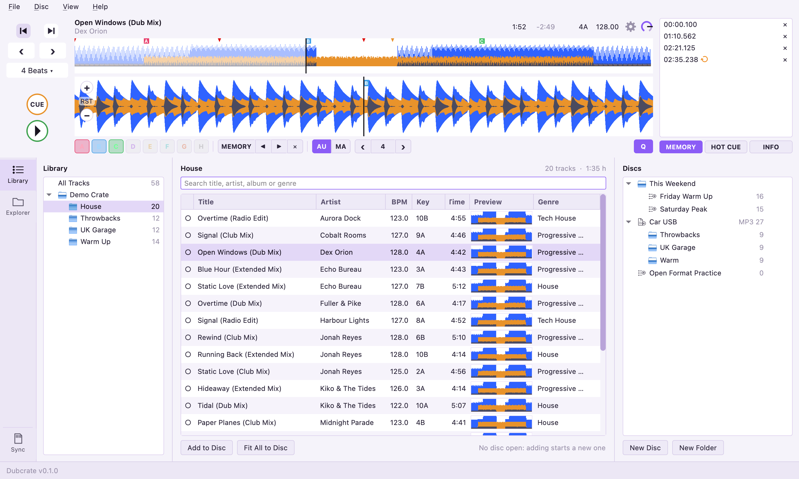
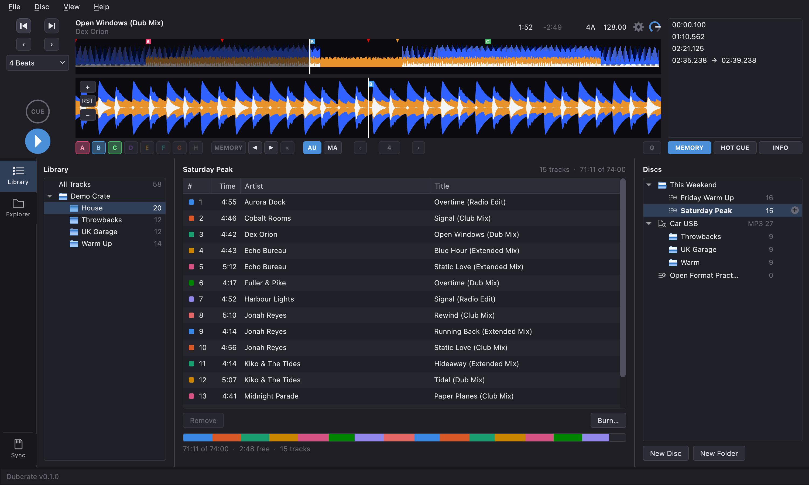
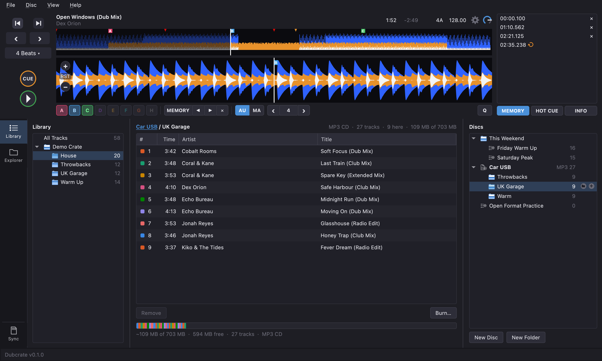
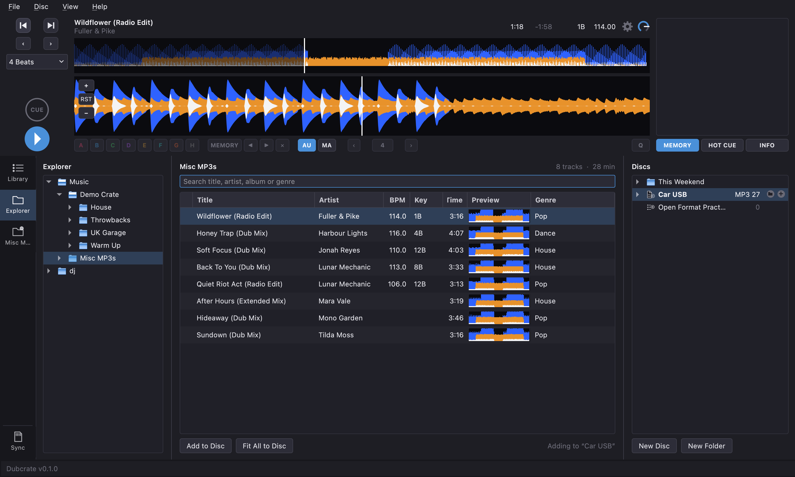
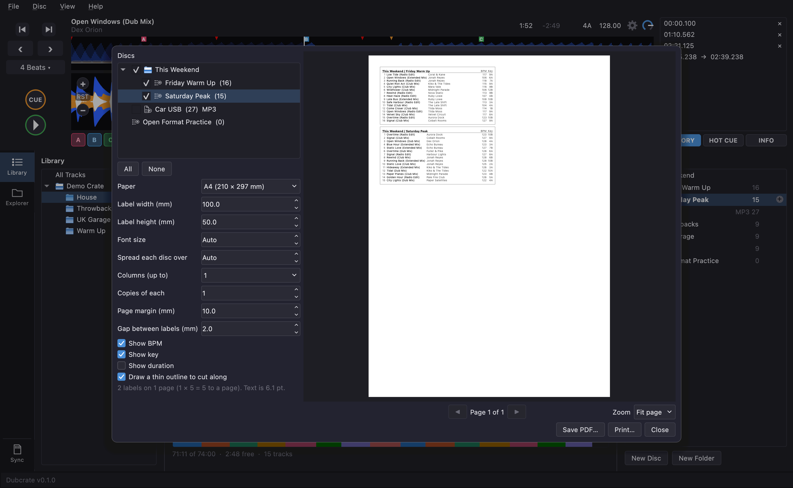
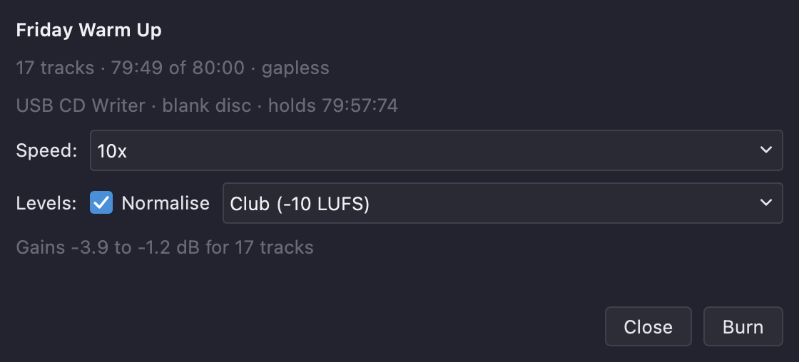
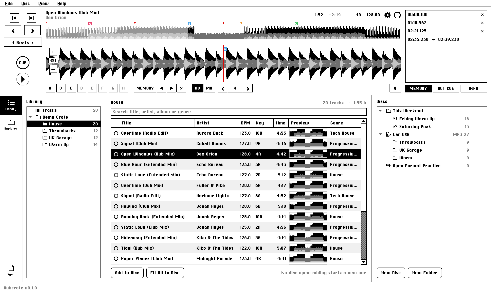

# Dubcrate

**Burn audio CDs and MP3 CDs for older CDJs, and print the index cards, from your DJ library.**

Older players like the CDJ-1000MK3 only play music from discs. Dubcrate lets you pick tracks from your rekordbox library
(or any folder of music), fit them onto discs exactly, and burn them. Track titles show on the player.
It can also put your cues on the player's SD card.

  <picture>
    <source media="(prefers-color-scheme: dark)" srcset="src/dubcrate/ui/help/screenshots/main-window-dark.png">
    
  </picture>

## What it does

- **Reads your music.** Your rekordbox library, a rekordbox USB stick or XML file, or any folder. It only ever reads them.
- **Plans discs** of 74 or 80 minutes. Drag tracks on, rename them, move them around. A bar shows how full the disc is.
- **Burns audio CDs** (with CD-TEXT titles) or **MP3 CDs** (with folders). It can even out the loudness.
- **Previews tracks** with smooth waveforms, beat grids and cue points. You can edit memory cues and loops too.
- **Syncs cues to a CDJ-1000MK3's SD card**, and brings back what you set on the player.
- **Prints index labels** for the case.
- **Finds a track at a gig:** one web page for your phone that says which disc a track is on.

<table>
  <tr>
    <td align="center"> A disc and its capacity bar</td>
    <td align="center"> MP3 CDs, with folders</td>
  </tr>
  <tr>
    <td align="center"> Explorer and pinned folders</td>
    <td align="center"> Index labels for the case</td>
  </tr>
  <tr>
    <td align="center"> The burn window</td>
    <td align="center"> Macintosh System 6 theme</td>
  </tr>
</table>

## What you need

- **A computer:** macOS 14 or newer (Apple Silicon or Intel), Windows 10 or 11 (64-bit), or 64-bit Linux (glibc 2.39 or newer).
  About 4 GB of memory and a screen of 1280 × 720 or more.
- **A CD burner** and blank **CD-R** discs. CD-RW isn't recommended for old players.
- **Music** as MP3, WAV, FLAC, AIFF, AAC/M4A, Ogg, Opus or WMA.
- Optionally, a **rekordbox 7** library.

## Download & install

Get the latest version from the [Releases page](https://github.com/martincurkovic/Dubcrate/releases).
Other than an optional daily check for updates, Dubcrate works offline.

**Mac.** Download `Dubcrate-macos-arm.dmg` (Apple Silicon) or `Dubcrate-macos-intel.dmg` (Intel). Open it and drag Dubcrate
to Applications. The app isn't signed, so macOS warns you the first time. To open it anyway:

1. Try to open Dubcrate. macOS shows a warning.
2. Open **System Settings ▸ Privacy & Security** and scroll down.
3. Click **Open Anyway** and confirm.

**Windows.** Run `Dubcrate-windows-x64-Setup.exe`. It isn't signed either, so SmartScreen warns you: choose
**More info**, then **Run anyway**. **Burning needs an administrator account.**

**Linux.** Unzip `Dubcrate-linux-x86_64.zip`, make the file runnable (`chmod +x`) and start it. If it won't start, install FUSE 2.
If Dubcrate can't use your drive, it tells you how to get access.

Rather build it yourself? See [BUILDING.md](BUILDING.md).

## Using Dubcrate

1. **Import your music.** *File ▸ Import Folder…*, or *File ▸ Import rekordbox Library…* (or **XML**, or **USB**).
   Your music shows on the left. The *Explorer* tab browses any folder or drive without importing.
2. **Find tracks.** Pick a playlist, or search. Click a column heading to sort.
3. **Build a disc.** *Disc ▸ New Disc*, then drag tracks on. Right-click a track for **Fit All Shown Tracks to Disc**.
4. **Watch the bar.** A disc can't be burned if it's too long or a file is missing.
5. **Burn it.** Press *Burn…*, load a blank CD-R and press Burn. Slower speeds are safer on old players.
6. **Print a label.** *Disc ▸ Print Labels…* lays out the track list for the case.

The keyboard shortcuts and everything else are in *Help ▸ User Guide*.

## What's coming

Other DJ libraries, such as Mixxx and Engine DJ.

## More

- **[User Guide](src/dubcrate/ui/help/manual.md)**, also in the app under *Help ▸ User Guide*.
- **[Changelog](CHANGELOG.md)**, **[building from source](BUILDING.md)** and **[notes for developers](CONTRIBUTING.md)**.

## License

Dubcrate is free software, released under the [GPL-3 (or later) license](LICENSE).
[Third-Party Notices](src/dubcrate/ui/help/THIRD_PARTY_NOTICES.md) are listed under *Help ▸ Third-Party Notices…*

The Macintosh System 6 theme uses the ChiKareGo2 font by Giles Booth (a recreation
of Chicago 12), licensed [CC BY](src/dubcrate/ui/fonts/README.txt). Dubcrate is not
affiliated with Apple, AlphaTheta or Pioneer DJ. rekordbox, CDJ and Pioneer DJ are
trademarks of their owners.
