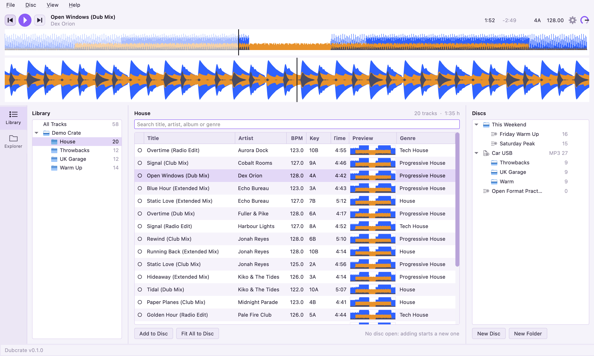
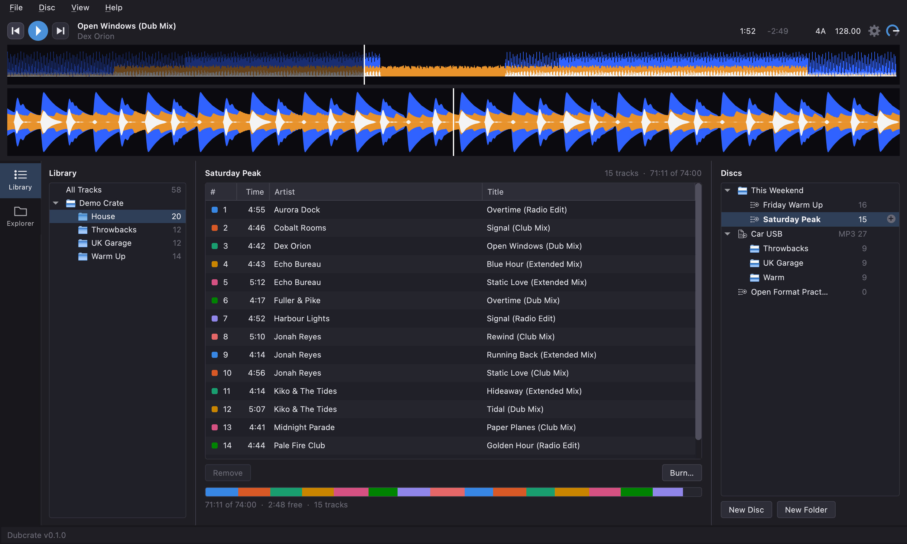
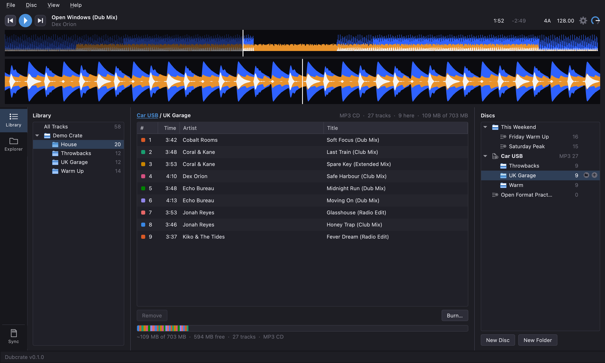
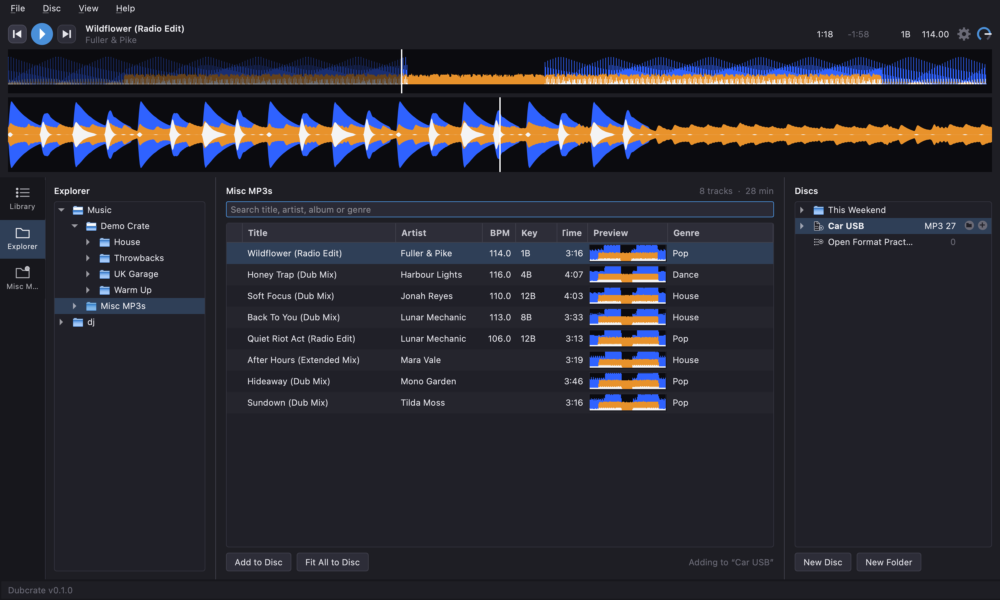
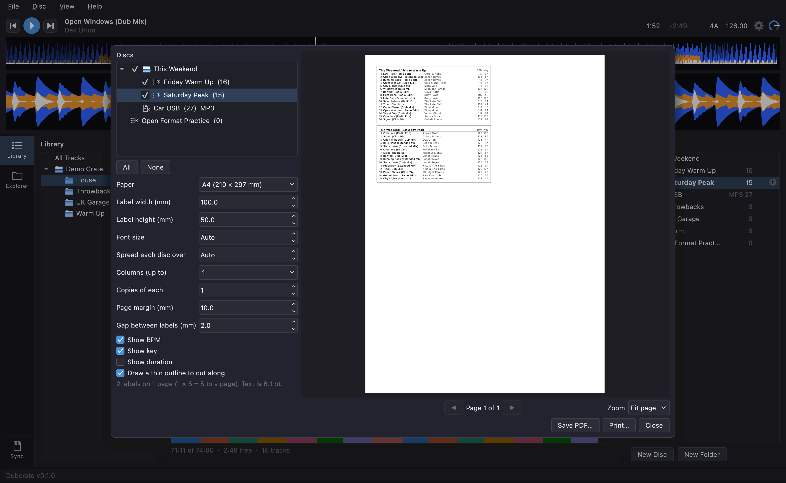
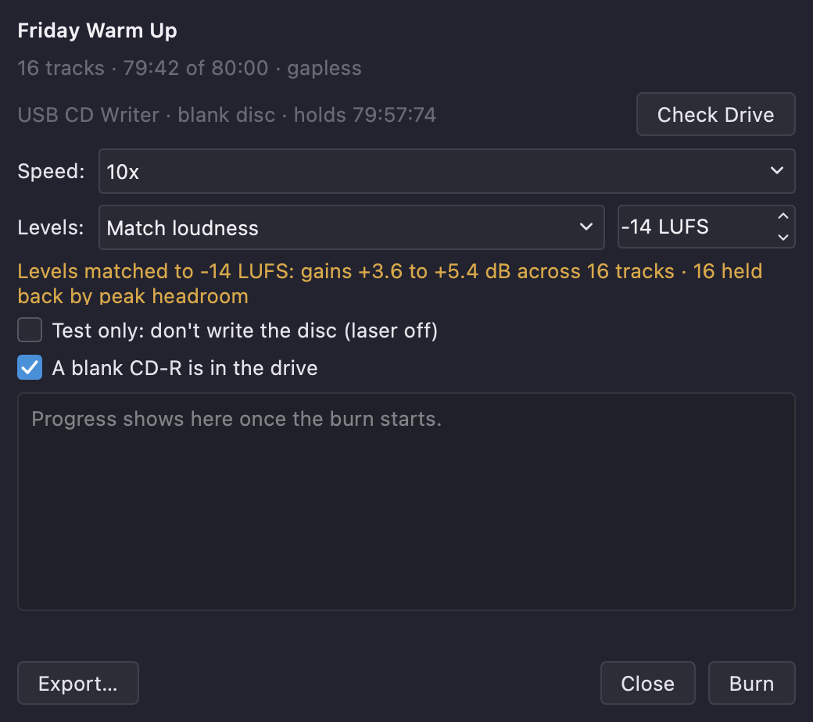
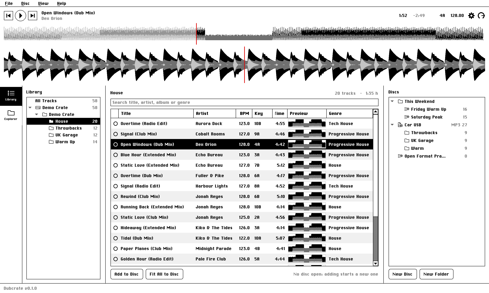

# Dubcrate

**Burn audio CDs and print index cards for old-style CDJs from your DJ library.**

Older players like the CDJ-1000MK3 play audio CDs only.
Dubcrate lets you pick tracks from your rekordbox library (or any folder of
music), plan CDs that fit exactly, preview them with waveforms, and burn audio CDs
with CD-TEXT so track titles appear on the CDJ.

  <picture>
    <source media="(prefers-color-scheme: dark)" srcset="src/dubcrate/ui/help/screenshots/main-window-dark.png">
    
  </picture>

## What it does

- **Imports your rekordbox library** (read-only), with your existing playlists.
- **Previews tracks** with a waveform. For rekordbox tracks it shows rekordbox's own waveform, beat
  grid, phrases and any cue points.
- **Plans discs** of 74 or 80 minutes. Drag tracks on, rename them, move them around.
- **Burns audio CDs with CD-TEXT**, or as MP3 discs.
- **Keeps its own playlists.** Your discs are saved in Dubcrate.

<table>
  <tr>
    <td align="center"> A disc and its capacity bar</td>
    <td align="center"> MP3 CDs, with folders</td>
  </tr>
  <tr>
    <td align="center"> Explorer and pinned folders</td>
    <td align="center"> Index labels for the case</td>
  </tr>
  <tr>
    <td align="center"> The burn window</td>
    <td align="center"> Macintosh System 6 theme</td>
  </tr>
</table>

## What you need

- **A Mac.** Windows and Linux are planned in the very near future.
- **A CD burner** that can write CD-R and blank
  **CD-R** discs. CD-RW works, but is not recommended for old CD players.
- **[ffmpeg](https://ffmpeg.org/)**, which Dubcrate uses to read tracks and prepare
  them for the disc. The download includes it; nothing to install. (Running from source: `brew install ffmpeg`.)
- **A player that reads audio CDs**.
- Music as **MP3, WAV, FLAC, AIFF, AAC/M4A, Ogg, Opus or WMA**.
- Optionally, an existing **rekordbox 7** library. rekordbox version 6 uses the same format and will likely work, but is untested.

## Download & installation

Download the latest `.dmg` from the [Releases page](https://github.com/martincurkovic/Dubcrate/releases)
(`Dubcrate-macos-arm.dmg` for Apple Silicon, `Dubcrate-macos-intel.dmg` for Intel Macs),
open it and drag Dubcrate to your Applications folder. It needs macOS 14 or later. Other than optionally checking for updates upon startup, Dubcrate works completely offline.

The app is not signed, because a signing certificate is hard to justify for a free
single-person project, so macOS will warn about it the first time. To open it anyway:

1. Try to open Dubcrate. macOS will warn about security.
2. Open System Settings ▸ Privacy & Security and scroll down.
3. Click **Open Anyway**, and confirm with your password or Touch ID.

If you would rather not trust a download, [BUILDING.md](BUILDING.md) builds it from source.

## Using Dubcrate

1. **Import your music.** *File ▸ Import rekordbox Library…*, or
   *File ▸ Import Folder…* reads a folder of music. Imported sources appear on the
   left (the *Library* tab), with their playlists and folders beneath them. The *Explorer* tab beside it
   browses the folders on your computer, or a plugged-in drive.
2. **Browse and listen.** Pick a playlist, search by title, artist, album or genre,
   and sort by clicking a column heading.
3. **Build a disc.** Your discs are playlists, listed on the right and can be filed in folders
   like rekordbox playlists. *New Disc* creates a new playlist for burning.
   **Fit All to Disc** adds tracks in order until the disc is full, and
   *Disc ▸ Split Shown Tracks Across Discs…* turns a long playlist into several discs.
4. **Check the bar.** It shows each track as a coloured block. A disc can't be burned
   if it is over its size or contains a track whose file can't be found.
5. **Burn it.** *Burn…* (or *Disc ▸ Burn Disc…*) shows the drive and asks you to confirm that a blank CD-R is
   loaded. Burn speed can be adjusted. It is recommended to use a slower burn speed for reliability, particularly with older CD players.
6. **Print an index label for the case.** *Disc ▸ Print Labels…* (⌘P) lays out the track list of
   one or several discs on sticker paper.

The keyboard shortcuts and other controls are in *Help ▸ User Guide*.

## Good to know

- **Your music and rekordbox library are never modified.** Dubcrate only reads them.
- **Cue points, beat grids and analysis are not burned to the CD.** An audio CD can't
  hold them and an old CDJ can't read them anyway. Dubcrate shows them so you can
  plan, but the disc holds only the audio and the titles.
- **Titles use CD-TEXT**, which handles Western European characters. Characters
  outside that set are simplified, or become a question mark, on the disc.
- **Discs are gapless** by default, but this setting can be changed.
- **Burn slowly.** Older CD players tend to read CD-R discs that have been burned at a lower speed more reliably.

## What's coming

Other DJ libraries (eg. Mixxx, Engine DJ), Windows and Linux support.

## License

Dubcrate is free software, released under the [GPL-3 (or later) license](LICENSE).
[Third-Party Notices](src/dubcrate/ui/help/THIRD_PARTY_NOTICES.md) are listed under *Help ▸ Third-Party Notices…*

The Macintosh System 6 theme uses the ChiKareGo2 font by Giles Booth (a recreation
of Chicago 12), licensed [CC BY](src/dubcrate/ui/fonts/README.txt). Dubcrate is not
affiliated with Apple, AlphaTheta or Pioneer DJ. rekordbox, CDJ and Pioneer DJ are
trademarks of their owners.
