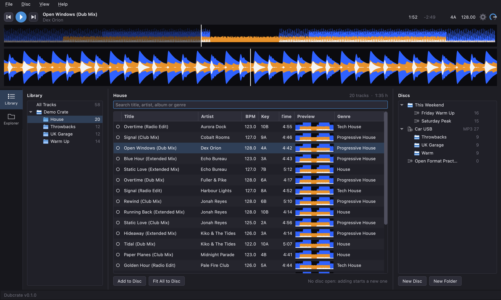
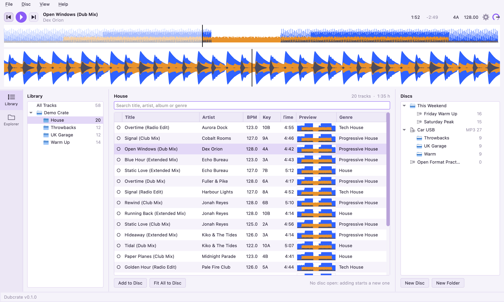
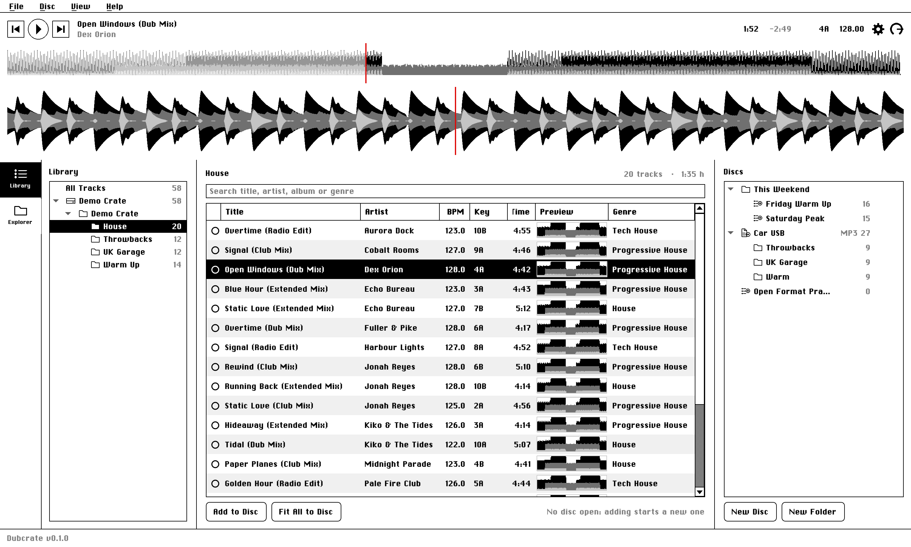
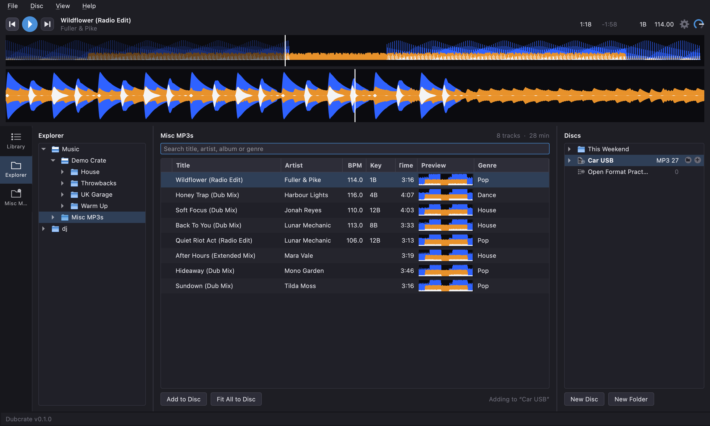
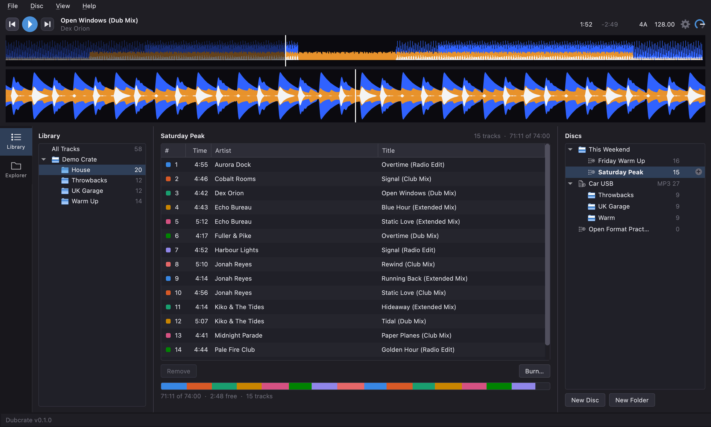
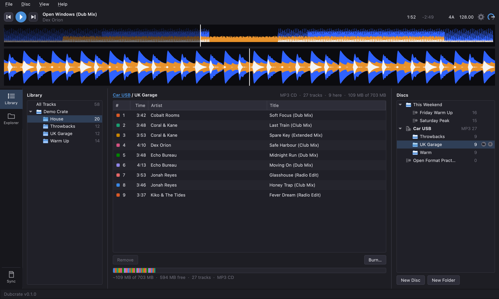
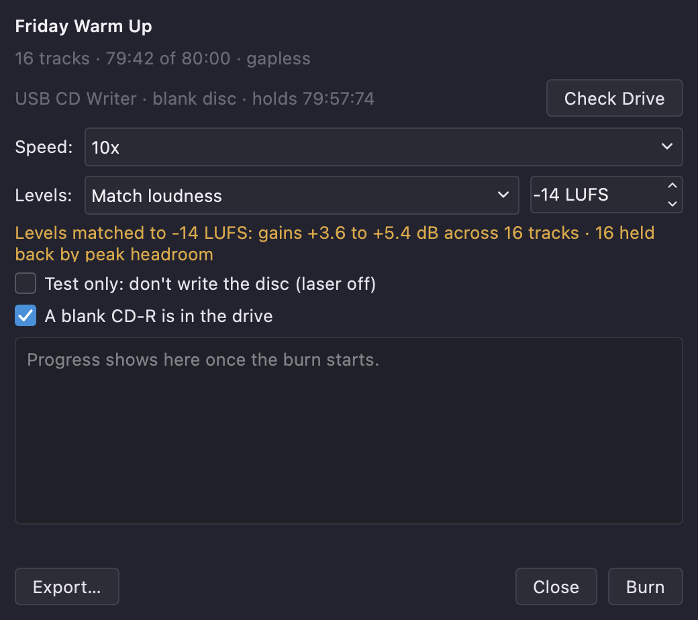
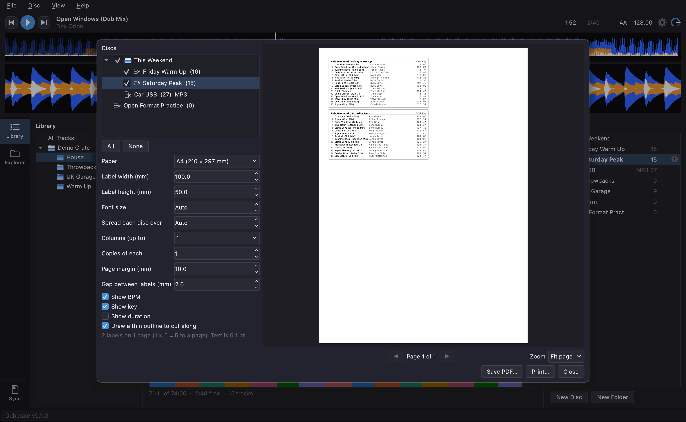
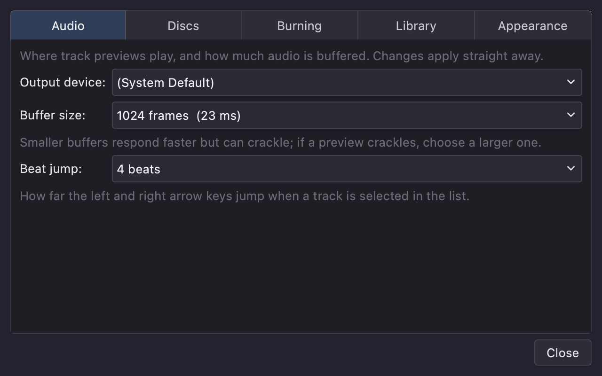

# Dubcrate User Guide

Dubcrate helps you put music from your rekordbox library (or any folder) onto audio CDs for older players such as the CDJ-1000MK3. You pick tracks, plan discs that fit exactly, preview them with waveforms, and burn CDs whose track titles show on the player's display.

> **Burning from the window is new.** It has been tried with a stand-in burner but not yet on a real drive. The command line is the route that has been proven: see [Burning a disc](#burning-a-disc).

---

## Contents

- [Getting started](#getting-started)
- [The main window](#the-main-window)
- [Importing your music](#importing-your-music)
- [Browsing and searching](#browsing-and-searching)
- [The Explorer](#the-explorer)
- [Listening to tracks](#listening-to-tracks)
- [Your discs](#your-discs)
- [Planning a disc](#planning-a-disc)
- [Checking tracks you already used](#checking-tracks-you-already-used)
- [Burning a disc](#burning-a-disc)
- [Printing labels](#printing-labels)
- [Settings](#settings)
- [Updates, and what Dubcrate sends](#updates-and-what-dubcrate-sends)
- [Keyboard shortcuts](#keyboard-shortcuts)
- [Troubleshooting](#troubleshooting)
- [Good to know](#good-to-know)

---

## Getting started

1. **Import your music.** Choose **File > Import Folder…** for a folder of music, or **File > Import rekordbox Library…** for your rekordbox library.
2. **Find some tracks.** Pick a playlist or folder on the left, or search.
3. **Build a disc.** Press **New Disc** on the right and type a name over the one it suggests, then drag tracks onto it, or select them and press **⌘Return**.
4. **Watch the bar.** It shows how full the disc is and turns red if the disc is too long.
5. **Burn it.** Open the disc by clicking it, press **Burn…**, check the drive, tick that a blank CD-R is inside, and burn.

Dubcrate comes with **ffmpeg** and **ffprobe**, which it uses to read tracks and to prepare them for the disc, so there is nothing to install. **Settings > Library** shows where it found each one and which version it is. (A copy you have installed yourself, for instance with Homebrew, is only used if Dubcrate's own is missing.)

---

## The main window



- **Library and Explorer** (left): two tabs down the left edge. **Library** is everything you have imported, with its playlists and folders beneath it; click one to see its tracks. **Explorer** browses the folders on your Mac or a drive without importing anything: see [The Explorer](#the-explorer).
- **Tracks** (middle): the tracks of whatever is selected on the left, with a search box above, and the buttons **Add to Disc** and **Fit All to Disc** below. When you open a disc, the middle shows that disc instead.
- **Player** (across the top): play and pause, previous and next, the title, time, key and BPM of the track you are previewing, a **cog** that opens Settings, a small **volume knob** (drag it up or down, hold Shift to go slowly, double-click to reset it), and two waveforms.
- **Discs** (right): your burn playlists, filed in folders. See [Your discs](#your-discs).

**View > Theme** switches between System, Light, Dark and Macintosh System 6 (black and white, with a bitmap-style font).





**Help > User Guide** opens this guide in its own window, which can stay open beside the app. Press **⌘F** in it to search the page, and click the links in the contents to jump to a section. **Help > Check for Updates…** looks for a newer version ([Updates](#updates-and-what-dubcrate-sends)), **Help > Third-Party Notices…** lists the licences of what Dubcrate includes, and **Help > About Dubcrate** shows the version.

---

## Importing your music

| Do this | To |
| --- | --- |
| **File > Import Folder…** (⌘O) | Read a folder of music. Each sub-folder becomes something you can browse. |
| **File > Import rekordbox Library…** (⇧⌘O) | Read your rekordbox library, with its folders and playlists in their running order. |
| **File > Re-import Selected Source** (⇧⌘R) | Bring the selected source up to date after you added or moved music. |
| **File > Remove Selected Source…** | Forget a source. Your music files are not touched. |

**Dubcrate keeps your rekordbox library up to date by itself.** Each time it starts, a splash screen shows while it re-reads a rekordbox library you have already imported, so tracks you added in rekordbox are there when the window opens. Afterwards the status bar says what changed (for example, "Brought in 12 new tracks from rekordbox"). Things to know:

- It only updates a library you imported yourself, and it never imports one on its own.
- Folders are **not** re-scanned at startup, because that takes too long. Use **File > Re-import Selected Source** (⇧⌘R) for those, or for a rekordbox update while Dubcrate is already open.
- If rekordbox's library is missing, locked or unreadable, Dubcrate skips it and tells you in the status bar. If rekordbox reports no tracks at all, Dubcrate doesn't believe it and keeps your library as it was.
- A track you deleted in rekordbox is removed here too, unless it is on one of your discs: that one is kept and marked, so no disc ever silently loses a track.
- Turn this off under **File > Settings… > Library**, or start with `dubcrate-gui --no-import`.

**Your music and your rekordbox library are never changed.** Dubcrate reads a temporary copy of the rekordbox database and only reads your audio files. It keeps its own library of imported track information and your discs.

If Dubcrate can't find your rekordbox library, choose **Choose File…** when it asks and pick `master.db`, normally in `~/Library/Pioneer/rekordbox/`. Version 7 is the version Dubcrate has been tried with.

Re-importing keeps your discs intact. A track that has vanished from its source but is on a disc is kept and marked, so a disc never silently loses a track.

Supported music: MP3, WAV, FLAC, AIFF, AAC/M4A, Ogg, Opus and WMA.

---

## Browsing and searching

- Click a source, playlist or folder on the left to list its tracks.
- Type in the **search box** to filter by title, artist, album or genre. Press **⌘F** from anywhere in the main window to jump to it.
- Click a **column heading** to sort by it, and click again to reverse.
- The marker, the Preview waveform and the short number and date columns have a **fixed width**, so they stay the same size when the window changes. The text columns can be resized by dragging the edge of their heading.
- **Drag a column heading** left or right to reorder the columns. The dot column stays first, and your layout is remembered.
- **Right-click a column heading** to show or hide columns, or choose **Reset Columns** to go back to the default layout and columns.

Only the essentials show at first: Title, Artist, BPM, Key, Time, the Preview waveform and Genre. Everything else is under **More Columns** in that menu, off until you switch it on:

| Column | What it shows |
| --- | --- |
| Album, Year | From the track's tags |
| Rating | rekordbox's star rating, as ★★★★☆ |
| My Tags | rekordbox's My Tag names, separated by commas |
| Label, Remixer, Composer | From rekordbox |
| Comment | The track's comment |
| Plays | How many times it has been played in rekordbox |
| Date Added | When it was added to rekordbox |
| Bitrate, Sample Rate, Format | The audio file's details |
| Path | Where the file is |

Click any of these headings to sort by it. rekordbox's own fields (Rating, My Tags, Label, Remixer, Composer, Plays, Date Added) are read when you import, so **re-import your rekordbox library once** (⇧⌘R) after updating Dubcrate to fill in the ones that are new. Music imported from a folder has none of rekordbox's fields.
- The dot at the start of a row shows where the track is: a filled **●** if it is on the disc you have open, an outline **○** if it is on another disc, and nothing if it is on no disc yet.

Tracks whose file can't be found are greyed out in the list, and shown in red on the disc. The file has moved, or the drive it lives on isn't connected. Reconnect it and re-import the source.

---

## The Explorer

The **Explorer** tab (the second tab down the left edge) is for music that isn't in a library you have imported: a folder of downloads, or a USB stick. There is nothing to import. Open the folders on the left and click one, and the audio files directly inside it appear in the track list, ready to preview, sort, search and add to a disc, exactly like the tracks of the Library.



- The tree starts at your **Music** folder and your **home folder**, and lists any **drives** plugged in (a USB stick or an external disk). It never offers the computer's whole system disk. Folders are read only when you open them.
- Dubcrate reads the tags of the files in a folder when you click it. A folder you have visited shows at once and is then checked again for files that came or went; a file that hasn't changed isn't read again.
- Only the **files directly inside** the folder you picked show, not those in its sub-folders: open the sub-folder to see them.
- Tags are just read, never worked out. A file with no BPM or key tag has them blank: Dubcrate doesn't analyse tracks (the CDJ-1000 can't use that data on a disc anyway), and the waveform you see when you preview is drawn from the audio itself.
- **A file that is also in rekordbox** (the same path) uses rekordbox's data: its BPM and key show in the list (rekordbox's win over the tags; the tags fill in what rekordbox leaves blank), and previewing it shows rekordbox's waveform, beat grid, cues and phrases. A file elsewhere, or a copy, is just a file. Rekordbox's data is read when you open the folder, so re-import rekordbox, then open the folder again, to pick up a change.
- **The Explorer's tracks are not part of your Library**: they don't appear in **All Tracks** or in a search of it. A track you add to a disc, though, is kept on that disc. Everything else the Explorer read is forgotten when Dubcrate next starts, and read again when you open the folder.
- If a folder can't be read, the status bar says why. On a Mac, the first time you open Documents, Downloads, Desktop or a drive, macOS may ask whether Dubcrate may read it; if you said no, allow it under **System Settings > Privacy & Security > Files & Folders**.
- A drive you plug in or take out while Dubcrate is open appears or goes away by itself a moment later (on a Mac and, we expect, on Linux; on Windows it is listed again when you next open the Explorer tab). If the folder you were looking at was on that drive, nothing is picked afterwards and the list keeps showing what it had. Right-click any folder and choose **Refresh** to list its sub-folders again (and, if it is the folder showing, to read its files again).
- Dubcrate remembers which tab and which folder you were on.

### Pinned folders

For a folder you use all the time (say, MP3s that aren't in rekordbox), **right-click it in the Explorer and choose Pin Folder**. It gets a tab of its own below Explorer, showing that folder and the folders inside it. Dubcrate stays on the screen you were on and says in the status bar that the folder is pinned; click the new tab when you want it. The folder is read again every time you open its tab, so files you have added since show up.

- **Drag a pinned tab up or down** to put your pins in the order you like (or right-click it and choose **Move Up** or **Move Down**). Library and Explorer always stay first and second. The order is remembered.
- With more pins than fit, the tab strip **scrolls** (mouse wheel or trackpad); a small arrow at the top or bottom shows there are more tabs beyond that edge, and the tab you pick is always scrolled into view.
- To remove a tab, right-click it (or the folder in any tree) and choose **Unpin Folder**. The folder and its files are not touched.
- A pinned folder on a drive keeps its tab when the drive is unplugged; the status bar says the folder isn't there until you plug it back in.
- The tab shows only the start of a long folder name; hold the pointer over it for the full path.

---

## Listening to tracks

**Double-click** a track to preview it, and press **Space** to play or pause (and **←** and **→** to beat jump). These keys work wherever you are in the window, except where you are typing, so the search box, a title you are editing and a setting you are typing into keep their keys. A slider keeps its own arrows, and in the Library and Discs lists **←** and **→** still close and open folders, but **Space** works there too. The **Preview** column shows the whole track as a waveform.

When a track plays to its end, the next one in the list (or in the open disc, in its order) starts by itself, skipping any file that is missing, and playback stops after the last. Pause, or choose another track, and it stays as you left it.

The two waveforms in the player:

- The **overview** shows the whole track. For rekordbox tracks it also shows the phrases (such as INTRO, CHORUS, DOWN, UP and OUTRO) and any cue points. Click anywhere in it to jump there.
- The **detail view** is zoomed in and scrolls past a fixed playhead, with the beat grid drawn on it. Use the mouse wheel to zoom, and drag it to scratch (below).

For rekordbox tracks the waveforms, beat grid, phrases and cues come from rekordbox's own analysis. For other music Dubcrate draws the waveform itself. Beat grids and cues are only shown for your planning: **they do not go on the CD.**

**Scratching.** Grab the zoomed waveform and drag it, as you would a CDJ's jog wheel. The waveform sticks to your pointer, and you hear the track move with it: drag right to take it back, left to move it forward, faster for a higher pitch, and hold still for silence. While your hand is on it, a playing track is held, and it carries on from wherever you let go. A paused track stays paused after you let go, so you can use this to find a spot. Clicking without dragging doesn't jump anywhere: to jump, click the overview.

**Beat jump.** With a track selected in the list, **←** and **→** jump back or forward by a set number of beats (4 unless you change it in **Settings > Audio**). The jump keeps its place within the beat, so the track stays in time, and it follows the beat grid, including any change of tempo. Tracks without rekordbox's beat grid use their tempo instead. A track with neither (say, an MP3 with no BPM tag that isn't in rekordbox) jumps a fixed **2 seconds**, whatever the setting. A playing track keeps playing.

**Waveform looks.** Choose how waveforms are drawn under **View > Waveform**, or in **Settings > Appearance**:

- **3-Band** is rekordbox's default: low frequencies in blue, mids in amber and highs in white.
- **RGB** colours each moment by what is in it: lows red, mids green and highs blue, mixing where they overlap.
- **Blue** is rekordbox's classic blue waveform: blue, with a whiter core where the sound is brighter.

The look applies to the overview, the detail view and the Preview column, and works for every track, with or without rekordbox's analysis. For RGB and Blue, Dubcrate works the colours out from the same three bands rather than reading rekordbox's own colour waveform, so they resemble rekordbox's without being identical.

**Waveform background.** The waveform follows your theme, so it is light in the light theme. If you prefer rekordbox's dark waveform whatever the theme, choose **Always dark** under **Settings > Appearance**. The Macintosh System 6 theme always draws the 3-band look in black and white.

Choose where previews play, and test it, in [Settings](#settings).

---

## Your discs

A disc is a playlist that goes on a CD. They live in the **Discs** list on the right, just as your rekordbox playlists live in the Library on the left, and they can be filed in folders.



- **Open a disc** by clicking it. Its tracks appear in the middle, ready to arrange and edit. Opening a disc also makes it the one that tracks are **added to**: its name is in bold, and under the track list it says **Adding to “…”**.
- **Add tracks** by selecting them and pressing **⌘Return**, **⌘D** or **Add to Disc** (they go to the open disc), or by **dragging** them from the track list onto any disc in the Discs list. Dragging onto a disc that isn't open adds to that one and leaves the open disc as it is.
- **New Disc** and **New Folder** (under the list) make them. The new disc or folder appears in the list at once with its name ready to type over: type a name and press **Return**, or press **Esc** to keep the suggested one. A new disc goes in the folder you have picked, or beside the disc you have picked.
- **Rename** a disc or folder by **double-clicking** its name, or by picking it and pressing **⌘R** (or right-click > **Rename**), then type and press **Return**. An empty name is ignored.
- **Delete** a disc or folder by picking it and pressing **⌘⌫** (or **Disc > Delete…**, or right-click > **Delete**). If it is empty it goes at once; if it has tracks or things in it, Dubcrate asks first, and **Yes** is the answer Return gives. Nothing you delete here touches the tracks in your library or your music files: a disc only lists tracks. **Take care with folders: deleting a folder deletes what is in it**, meaning the discs and folders inside it, at any depth. The question says how many.
- **The + button** does the same in one click, as in rekordbox. Click a row and a **+** appears at its right-hand end: on a folder it makes a disc inside the folder, and on a disc it makes another disc beside it, in the same folder. The new disc's name is ready to type over.
- **A disc that is too long** is marked with an orange **\*** before its track count. Hover over it to see how far over it is. It can still be saved, but it can't be burned until it fits.
- **Drag a disc or folder** into a folder to file it, or onto empty space to move it to the top level. Folders can hold folders.
- **Right-click** a disc to open, rename, duplicate, burn or delete it, or a folder to make something inside it, rename it or delete it. Deleting a folder deletes the discs and folders in it too.
- Discs and folders are listed A to Z, with folders first.

**Audio CDs and MP3 CDs.** A disc is an **audio CD** (the default) or an **MP3 CD**. An audio CD plays in any CD player and is measured in minutes (80 or 74, see Settings). An MP3 CD is a data disc of MP3 files, for players that read MP3 discs such as the CDJ-1000MK3; it is measured in megabytes (about 703 MB on an 80-minute disc), so it holds hours of music, has no 99-track limit and no gaps setting. Make one with **Disc > New MP3 Disc** (⇧⌘N) or right-click > **New MP3 Disc**, and switch an existing disc with right-click > **Make MP3 CD** / **Make Audio CD** (its tracks stay). Its title and size say **MP3 CD**, and in the Discs list an MP3 disc has its own icon (a page of files with a disc) and says **MP3** before its track count. Files on an MP3 disc are always **constant bitrate** (CBR), because variable-bitrate (VBR) files are slow to load on a CDJ: lossless files (FLAC, WAV, AIFF) are encoded at **320 kbit/s**; an MP3 that is already constant bitrate is copied as it is; a VBR MP3 is encoded to constant bitrate; and a lossy file below 320 keeps its own rate (a 245 kbit/s file becomes 256), since encoding it higher would only make it bigger. **Settings > Discs** can lower the top rate for new discs. Artist and title edits for the disc are written into the files' tags, and files are named `01 Artist - Title.mp3`, `02 …`, so players that sort by name keep your order.

**Folders on an MP3 CD.** An MP3 disc can hold folders, like a folder on a USB stick, and its folders are listed under it in the Discs list (open the little arrow beside it). Click a folder to see and edit its tracks in the middle; click the disc itself to see the tracks in its root. The bar under the tracks always shows the whole disc.



- **Make a folder** with the little **folder button** that appears beside the **+** when you pick an MP3 disc or one of its folders: it makes a folder *inside* the one you picked. The **+** on a folder makes one *beside* it, at the same level (on the disc itself, the + still makes another disc). Right-click > **New Folder on Disc** or **New Folder Inside** does the same as the folder button. Name it in place, as for a disc.
- **Move around** by clicking a folder in the Discs list, or by clicking a step in the path above the tracks (for example **Super Cool Trax 001 / some stuff / more stuff**): every step but the last is a link, and the disc's name takes you back to its root.
- **Add tracks to a folder** by opening it and adding as usual (⌘Return, **Add to Disc**), or by dragging tracks from the track list onto the folder in the Discs list.
- **Move tracks between folders** by dragging them from the middle onto a folder (or onto the disc, for its root), or by right-clicking them > **Move to Folder**.
- **Delete a folder** with ⌘⌫, or right-click > **Delete Folder from Disc…**. Its tracks come off the disc and its folders go too, at any depth, after a question that says how many (nothing at all is asked if it is empty). The tracks stay in your library.
- **Folders have limits**, which are the CDJs': at most **999 files in a folder**, **99 folders** on a disc (the disc's root counts as one) and **8 levels** (the root counts as the first). Dubcrate stops you at each. Files are numbered from 1 again in every folder (`01 Artist - Title.mp3`).
- Making an MP3 disc an **audio CD** removes its folders, after asking, and lists its tracks folder by folder.

**When a playlist gets too long.** If adding tracks makes an audio CD longer than it holds (or past 99 tracks), Dubcrate asks whether to **make it an MP3 CD** instead. Say no and it stays an audio CD, marked as too long; it asks once per disc until you restart.

**A burned disc is just a disc.** There is no separate record and nothing is frozen: you can keep editing a disc after you burn it. Dubcrate only remembers *when* it was last burned: hover over the disc to see it, and you'll be reminded if you add a track that is on a disc you burned. To keep a copy of a mix before you change it, right-click it and choose **Duplicate**.

---

## Planning a disc

The disc you open is shown in the middle: its tracks as they will be written on the CD, and a capacity bar under them.

**Adding tracks**

- Drag tracks from the track list onto the disc, **or** select them and press **⌘Return**, **⌘D** or **Add to Disc**.
- **Fit All to Disc** adds every track shown, in order, until the disc is full.
- **Disc > Split Shown Tracks Across Discs…** (⇧⌘D) cuts a long list into as many discs as it takes, keeping the order.
- If you add tracks and no disc is open yet, one is created for you.

**What goes on the CD**

The disc list shows only what a CD can hold: the track **#**, its **Time**, and the **Artist** and **Title** that are written to the disc as CD-TEXT and shown on a player's display. The CD's own title (the "album") is the **disc's name**: double-click it in the Discs list to rename it.

You can change the artist and track name for the CD without touching anything else. **Double-click** an artist or title and type:

- The edit is for **this disc only**. It never changes your rekordbox library, the original audio file, or the same track on another disc.
- An edited cell is shown in *italics*. Hover over it to see what the library has, and clear the text to go back to that.
- Edits stay with their track when you reorder the list or add and remove others.
- **Duplicate** keeps the edits in the copy.
- Characters CD-TEXT can't show are simplified when the disc is burned (see [Good to know](#good-to-know)).

**Arranging**

- Drag rows up and down to reorder them.
- Select rows and press **Delete** (or click **Remove**) to take them off the disc.
- **Double-click** a track's number or time to listen to it. **Space** plays and pauses, and **←** and **→** beat jump, as in the track list.

**Size and gaps**

New discs are planned for **80 minutes** and are **gapless**: no silence between songs, so the most music fits. Change either under **File > Settings… > Discs** (see [Settings](#settings)). The new choice applies to discs you create from then on; a disc keeps the size and gaps it was made with.

The disc size you plan for is only a guide. When you burn, **the disc in the drive is what counts**: see [Burning a disc](#burning-a-disc).

**The capacity bar**

The bar under the list shows each track as a coloured block, with the time used and the time left. When a disc is over its size, the bar still shows everything and marks where the disc would end. A CD holds at most **99 tracks**, and Dubcrate stops adding at that point.

A length shown with **~** is an estimate. Dubcrate measures each track's exact length when you add it and again when the disc is prepared, and the prepared length is the one that counts.

A disc can't be burned if it is empty, over its size, or holds a track whose file is missing or no longer in its source. When it's ready, press **Burn…**: see [Burning a disc](#burning-a-disc).

---

## Checking tracks you already used

When you add a track that is **already on this disc or on another disc**, Dubcrate asks before adding it:

> 2 of the 5 tracks are already used:
>
> • Artist - Title: already on this disc; on "Friday night" (burned 2026-11-01)
>
> Add them anyway, or skip the duplicates?

Choose **Add Anyway** to add everything, **Skip Duplicates** to add only the tracks that aren't used anywhere yet, or **Cancel** to add nothing. Return chooses **Add Anyway**. **Skip Duplicates** is left out when every track is already used, since there would be nothing to add. A track counts as a duplicate if it is on this disc or on any other disc, and the status bar tells you how many were skipped. The notice names each place a track is used, and lists the first eight tracks if there are more.

**The same file counts as one track**, even when it is in rekordbox and in an Explorer folder: if the rekordbox copy is on a disc, the Explorer copy is flagged as used too (and the other way round). Dubcrate tells them apart by the file's path, ignoring capital letters, so a copy of the file in another place is a different track. The ● and ○ marks in the track list follow the same rule.

A disc you burned says when. A test write (a simulated burn) puts nothing on a disc, so it doesn't count as a burn.

---

## Burning a disc

> **A real burn uses up a blank CD-R.** Use a blank **CD-R**, not a CD-RW, which old players read badly.



**From the window**

1. Open the disc, then press **Burn…** under its tracks (or choose **Disc > Burn Disc…**, ⌘B, or right-click the disc in the Discs list and choose **Burn…**).
2. Put a blank CD-R in the drive. Dubcrate asks the drive what is inside and shows it: the drive's name, whether the disc looks blank, and how much it holds. Press **Check Drive** after changing the disc. An MP3 CD is written as a data disc (ISO 9660 with Joliet names), and the burn window says **MP3 CD** at the top.
3. Check the **Speed**. It starts at your default from **File > Settings… > Burning**; change it here to use another speed for this burn only.
4. Tick **A blank CD-R is in the drive**. The **Burn** button stays grey until you do, and Return never starts a burn.
5. Press **Burn**. The log shows each track being prepared and then the burn. The window can't be closed until it finishes.

Things to know:

- Dubcrate **won't burn** if there is no disc, if the music is longer than what the disc holds (a 74-minute disc with 78 minutes planned, say), or if the disc can't be burned as planned. The reasons are listed in red. If the drive can't say how much a disc holds, Dubcrate goes by the size the disc was planned for.
- **Levels** (audio CDs): **Match loudness** gives each track one fixed volume change so the tracks on the disc play at about the same loudness, and shows the range of changes it will make (for example "gains -6.0 to +3.2 dB across 16 tracks"). It never compresses or limits, so the music keeps its dynamics. A track is never turned up so far that its peaks would clip: one that can't reach the target without that is lifted as far as is safe and counted as **held back by peak headroom**. The target is in LUFS (a loudness scale; -10 keeps loud dance tracks close to how they were, -14 is gentler and holds nothing back) and starts at your choice in **Settings > Burning**. The first time a track is measured takes a moment (it is remembered after that, until the file changes). The same setting applies to **Export…**, MP3 discs are left as they are, and your music files are never changed: only the copy written to the disc is.
- **Test only** runs everything except writing to the disc (the laser stays off), which is a safe way to check your drive. A test doesn't mark the disc as burned.
- After a real burn the disc is marked as burned, and it stays open and editable. Ticking the box is needed again before every burn.
- A failed burn says why in the log, and the disc is not marked. A burn can't be stopped once it has started.

**Exporting instead of burning**

**Export…** (bottom left of the burn window) writes the disc as files, so you can burn it with another program or on another computer, and it needs no drive. It makes a new folder, named after the disc, inside the folder you choose (it never overwrites anything):

- An **audio CD** gives one WAV per track (`01 Artist - Title.wav` and so on, each a whole number of CD sectors, so tracks join exactly), `disc.toc` (a table of contents for the free program [cdrdao](https://cdrdao.sourceforge.net), with the CD-TEXT), and a `README.txt` with the commands.
- An **MP3 CD** gives the folder that goes on the disc, `disc.iso` (the same disc as an image any program can burn, made when a tool for it is installed: on Linux, `xorriso`), and a `README.txt` beside them that says how to burn it as a data CD.

On a computer that can't burn from Dubcrate, the burn window says so and Export… is the way to get a disc (on Linux, Dubcrate burns with `cdrdao` when it is installed, but that is new and has not been tried on a real drive; Windows isn't supported yet). Exporting does not mark the disc as burned.

**From the command line**

The command line does the same job. Put the disc number in place of `1` (the number is shown by `dubcrate disc list`).

```
dubcrate burn 1                      # a dry run: checks the disc and burns nothing
dubcrate burn 1 --yes --simulate     # a laser-off test write, with a disc in the drive
dubcrate burn 1 --yes                # really burns
```

- The dry run lists anything that stops the disc being burned.
- Before burning for real, Dubcrate asks the drive about the disc inside. It says how much the disc holds, and **refuses to start if the music won't fit** (for example, a 74-minute disc with 78 minutes planned). It also stops if the drive says there is no disc. If the drive can't tell, Dubcrate goes by the size the disc was planned for.
- **`--speed`** sets the burn speed. The default is 10x. **Burn slowly:** old players read discs burned at a low speed more reliably.
- Every track is converted to CD quality (16-bit, 44.1 kHz stereo) and the disc gets **CD-TEXT** titles, so the artist and title show on the player.
- After a successful real burn, Dubcrate marks the disc as burned.
- `dubcrate export 1 ~/Desktop` does what **Export…** does, into a new folder inside `~/Desktop`.
- `--levels match` (with `--target -10`) on `burn` and `export` matches the loudness of an audio CD's tracks, as **Levels** in the window does.

The full list of command-line options is in the project's developer notes.

---

## Printing labels

Old players have no screen for a track list, so Dubcrate can print one for the case: **index labels** with each disc's track list, on sticker paper in your ordinary printer. Choose **Disc > Print Labels…** (⌘P), or right-click a disc in the Discs list and choose **Print Labels…**. It works for audio CDs and MP3 CDs.

> **Printing has been checked by saving PDFs, not yet on a real printer.** Try **Save PDF…** and look at it first, or print on plain paper and hold it against a sticker sheet.



1. **Tick the discs** to print, on the left. The disc you opened is ticked already. **All** and **None** tick or clear the list.
2. Choose the **Paper**: A3, A4, A5, A6, US Letter or US Legal.
3. Type the size of one label: **Label width** and **Label height**, in millimetres. 100 × 50 is a good start for a case.
4. **Font size** is **Auto** (the text as large as fits, up to a limit, so a short list isn't blown up) unless you choose a size in points. The line under the settings says what Auto came to, which is a good place to start.
5. **Spread each disc over** says how many labels one disc's list is divided between, for a case with several areas to stick on. **Auto** (the default) uses the fewest labels that keep the text readable, at least 6 pt, or the size you chose: a short disc gets one label and a 60-track MP3 CD gets several. Each label is headed with the disc's name and *1/2*, *2/2*.
6. **Columns (up to)** (1, 2 or 3) lets a long list run in columns on a label, so fewer labels are needed. Each row then reads *Title – Artist* on one line, so long names are cut short with “…”, and the BPM, key and duration columns are smaller. A disc uses as few columns as will do, so a short disc stays in one column even when you allow three. On a 10 × 5 cm label, 60 tracks need about four labels in one column, or two labels in two columns.
7. **Copies of each** prints every disc's labels again for each copy you burned: burn a disc twice and set 2.
8. **Page margin** keeps clear of the edge your printer can't print to (10 mm suits most), and **Gap between labels** leaves room to cut.
9. Press **Print…**, or **Save PDF…** to get a file.

What is on a label: for each track, its **number**, **title** and **artist**, and, each with a box of its own, the track's **BPM** (**Show BPM**, rounded to a whole number), **key** (**Show key**) and **duration** (**Show duration**, minutes:seconds, as in the track list's Time column). BPM and key start ticked; duration is off until you tick it. The BPM and key come from your rekordbox library, so a track from a plain folder has neither and those columns stay empty. The key is written the way **Settings > Appearance > Key notation** says. The title and artist are the ones written on the CD, including any edits you made for this disc. For a crowded MP3 disc you may prefer to untick **Show BPM** and **Show key** (and leave **Show duration** off), which gives the titles more room.

**Folders on an MP3 disc** are headings in the list. The tracks on the disc's root come first, then each folder in alphabetical order, as a player lists them, and a folder inside another is named by its path (*Sets / Friday*). Numbers start again at 1 in every folder, as the files on the disc are numbered. A folder is kept together on one label where that is readable; one too long for a label is cut, and the next label picks it up under the same heading with *(cont.)*. A disc with no folders is just a numbered list.

The labels of every ticked disc are laid out one after another, left to right and top to bottom, so **several discs share a page** and little sticker paper is wasted. The preview shows each page, with **◀** and **▶** to turn them. The **Zoom** box, **pinching** on a trackpad, or Ctrl and the mouse wheel zoom in to check the small print, sharp at any size, around the point you zoom on; drag the page to move it when zoomed in. A pinch can stop between the box's sizes, and the box then shows the size it reached. If a list is too long for the label's height (at a size you chose, or too small to read on Auto), a red note under the settings says which disc and suggests what to change (it has its own space, so it never moves the controls): a taller label, more columns, more labels, or a lower font size. A label that doesn't fit the paper with those margins can't be printed. **Draw a thin outline to cut along** draws a hairline round each label, which you can turn off if you cut exactly.

Your choices are remembered for next time.

---

## Settings

**File > Settings…** (⌘,) has five tabs:



- **Discs:** how **new** discs are planned: **Plan new discs for** 80 or 74 minutes (the same size, as megabytes, for an MP3 CD), **Between tracks**, which is **Gapless** unless you choose 1, 2 or 3 seconds of silence (audio CDs only), and **MP3 CDs: highest rate**, the top constant bitrate for new MP3 discs (320 kbit/s unless you lower it).
- **Burning:** the **Burn speed** a burn starts with (10x unless you change it). Old players read discs burned slowly more reliably, and 10x to 16x is a good range. Your drive may not offer every speed. You can still pick another speed for a single burn in the burn window. **Track levels** chooses whether a burn starts with **Match loudness** on, and its **Target loudness**; see [Burning a disc](#burning-a-disc).
- **Audio:** the **Output device** for previews and the **Buffer size**, with a button that plays a short test tone, and the **Beat jump** distance for the arrow keys.
- **Library:** whether Dubcrate updates your rekordbox library each time it starts (on by default), and whether it checks for a newer version of Dubcrate when it starts (also on by default; see [Updates](#updates-and-what-dubcrate-sends)).
- **Appearance:** the **Theme** (the same choice as **View > Theme**), the **Waveform style** (the same as **View > Waveform**), the **Waveform background**, and the **Key notation**: **Camelot** (8A) or **Musical** (A min). Only what is shown changes; your library, rekordbox and the files keep what they have.

---

## Updates, and what Dubcrate sends

Dubcrate checks for a newer version when it starts, at most once a day, and tells you only if there is one: a notice with the release notes and a **View Release…** button that opens the download page. **Skip This Version** silences the notice for that version, and **Remind Me Later** leaves it for tomorrow. Either way, a small blue **Update available** button appears next to the version (**Dubcrate v0.1.0**) at the bottom left of the window for as long as a newer version exists: click it to read what's new. Nothing is downloaded or installed by Dubcrate itself; you download the new `.dmg` yourself.

**Help > Check for Updates…** (or the button in **About**) checks straight away and tells you the result, even "you're up to date". Turn off the check at startup under **File > Settings… > Library > Check for a new version when Dubcrate starts**.

This is the only time Dubcrate uses the network. It asks `github.com` for the list of Dubcrate's published releases; it sends nothing about you or your music, only the name and version of the app, as any request must. The version in **Help > About Dubcrate** is the one that is compared, so a build you made yourself that says `development` or `0.0.0-dev` never checks.

---

## Keyboard shortcuts

**Help > Keyboard Shortcuts** (⌘/) opens the full list in a window you can search and keep open; it is made from the menus, so it is always right. The main ones:

| Shortcut | Does |
| --- | --- |
| Double-click a track | Preview it |
| Space | Play or pause (anywhere except a text box) |
| Return | Load the highlighted track into the player and play it |
| ⌘Return, or ⌘D | Add the selected tracks to the disc (to the folder shown, on an MP3 disc) |
| ← / → | Beat jump back / forward (anywhere except a text box, a slider or a folder list) |
| Drag the zoomed waveform | Scratch |
| Delete | Take the selected tracks off the disc |
| ⌘O | Import a folder |
| ⇧⌘O | Import a rekordbox library |
| ⌘R | Rename the picked disc or folder |
| ⇧⌘R | Re-import the selected source |
| ⌘⌫ | Delete the picked disc or folder |
| ⌘/ | Show this list of shortcuts |
| ⌘N | New disc |
| ⇧⌘N | New MP3 disc |
| ⌘B | Burn the disc |
| ⌘P | Print labels |
| ⇧⌘D | Split the shown tracks across discs |
| ⌘, | Settings |
| ⌘F | Find tracks: go to the search box (**View > Find Tracks**) |
| ⌘F (in the guide) | Find in the guide |

---

## Troubleshooting

- **A preview crackles.** Raise the buffer size in **Settings** (try 2048 frames).
- **No sound, or the wrong output.** Choose the output device in **Settings** and press the test tone button.
- **Dubcrate says it can't find ffmpeg.** The download includes it, so this means the app has been damaged or changed: download it again. If you run Dubcrate from source, install it with `brew install ffmpeg` and restart. Your library, rekordbox import and previews of MP3, WAV and FLAC files still work without it, but folder import and burning don't. **Settings > Library** shows what Dubcrate found.
- **New tracks from rekordbox aren't showing.** Dubcrate updates rekordbox when it starts, and only if **Settings > Library** is on. To update while it is open, select the rekordbox source and press ⇧⌘R. If the status bar said it couldn't update, it says why.
- **Dubcrate can't find my rekordbox library.** Choose **Choose File…** when importing and pick `master.db`.
- **A track is greyed out, or its file is missing.** Reconnect the drive or put the file back, then re-import the source (⇧⌘R).
- **The Burn button is grey.** Read the red lines in the burn window: the disc may be empty, too long for the disc in the drive, or missing a file. Also tick **A blank CD-R is in the drive**, and press **Check Drive** if you just changed the disc.
- **A disc is over its size.** Take tracks off, switch to a longer disc size, or split the playlist.
- **Something went wrong and I want to report it.** **Help > Show Log File** opens the folder with Dubcrate's log (`dubcrate.log`, and `crash.log` if it ever crashed). Attach them to the report. They list file paths and what Dubcrate did, never your audio. Starting Dubcrate with `--verbose` records more detail.
- **An MP3 CD won't play, or its tracks are in the wrong order.** Not every player reads MP3 discs, and old ones can be fussy about file names and burn speed. Burn a test disc slowly, and tell the project what your player did, so this guide can say what is known.
- **A track says it is no longer in its source.** It disappeared from the source at the last re-import but is kept because a disc uses it. Take it off the disc before burning.

---

## Good to know

- **Number boxes work like knobs.** Press on one and drag up or down to change it (hold Shift for fine steps), or click it once to select the whole number and type a new one (Return applies). The little arrows and the arrow keys still work.
- **Titles use CD-TEXT**, which handles Western European characters. Other characters are simplified, or become a question mark, on the disc.
- **The disc holds only audio and titles.** Cue points, beat grids and rekordbox analysis can't go on an audio CD.
- **Everything is converted to CD quality** when burned, so a high-resolution file becomes 16-bit, 44.1 kHz.
- Dubcrate keeps its library in `~/Library/Application Support/Dubcrate/`.
- Dubcrate is free software under the GNU General Public License, version 3 or later. It is not affiliated with Apple, AlphaTheta or Pioneer DJ. rekordbox, CDJ and Pioneer DJ are trademarks of their owners.
