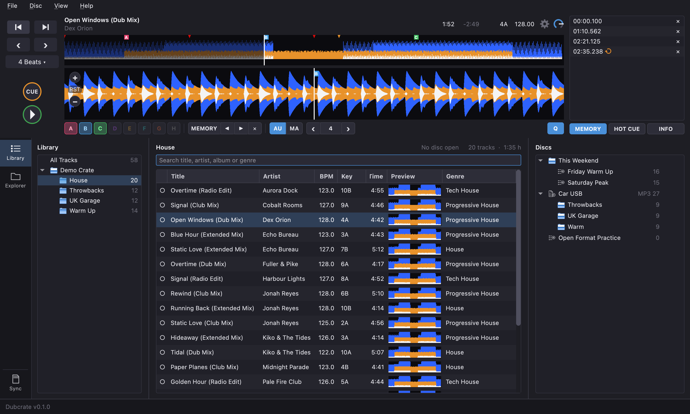
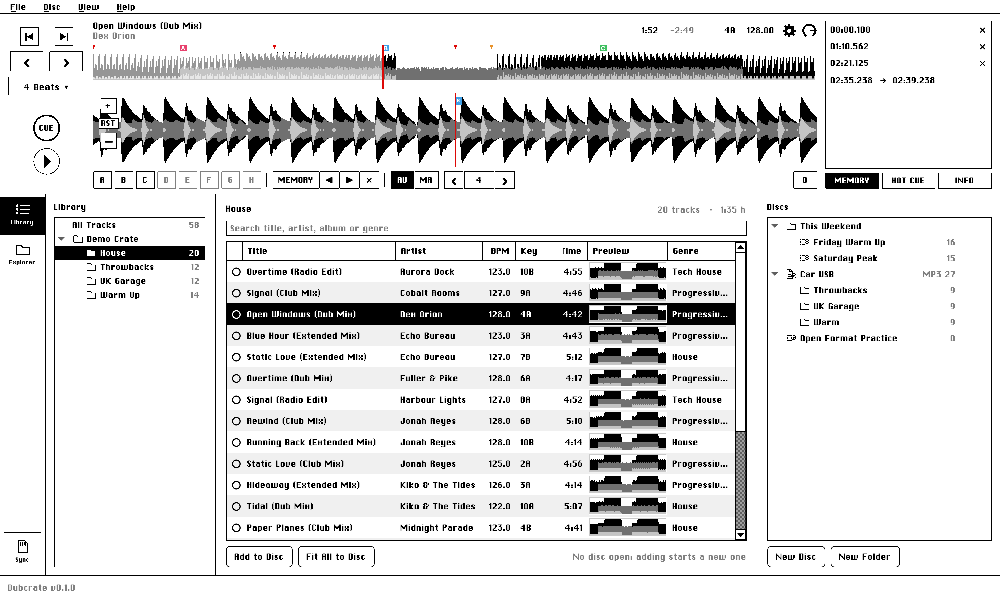
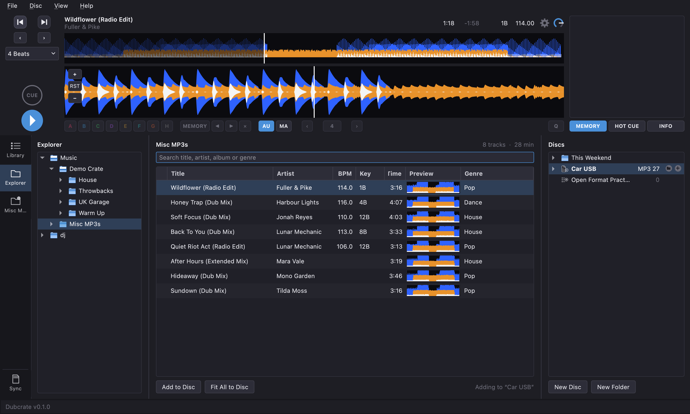
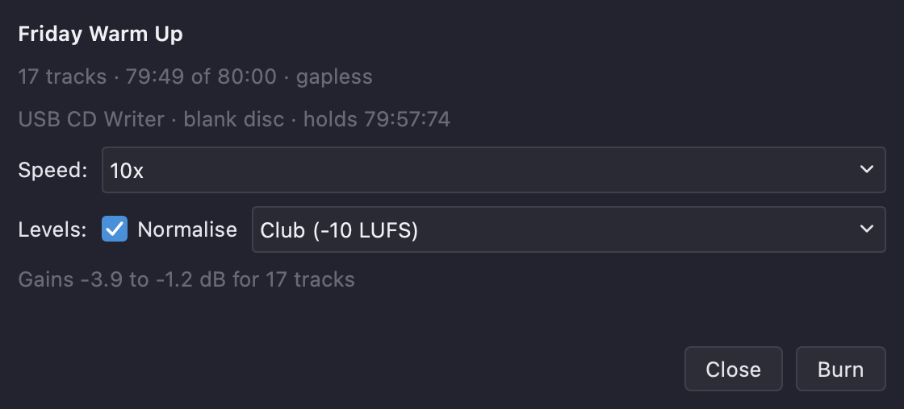
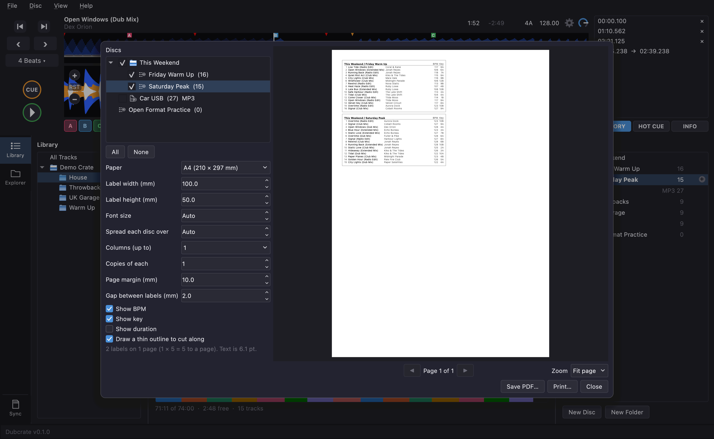
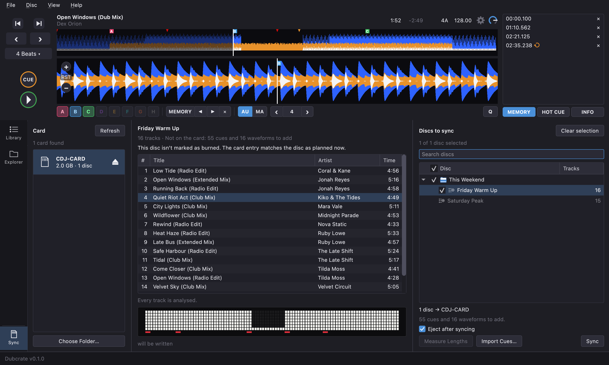
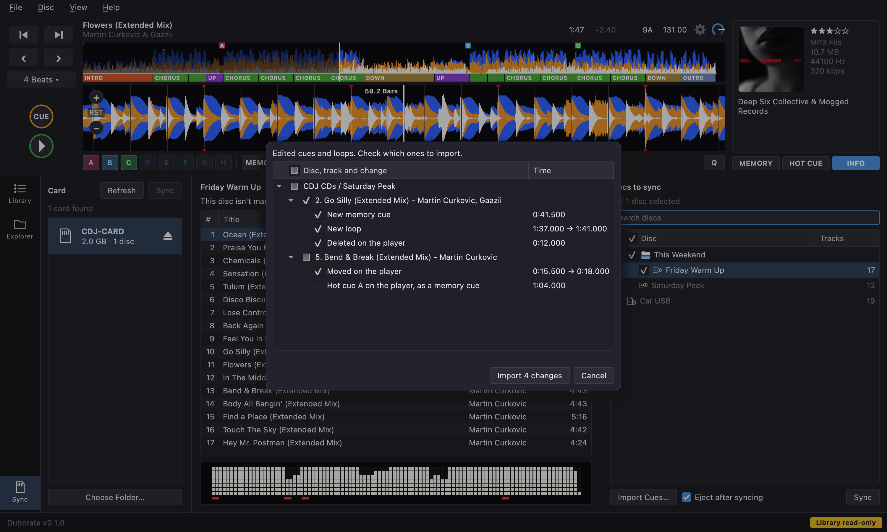
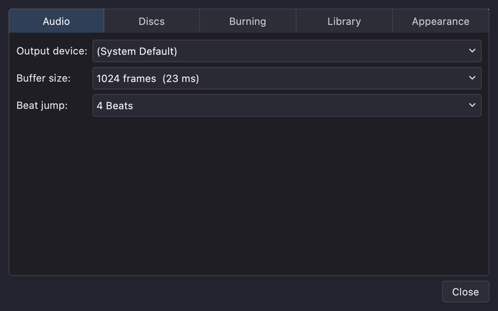
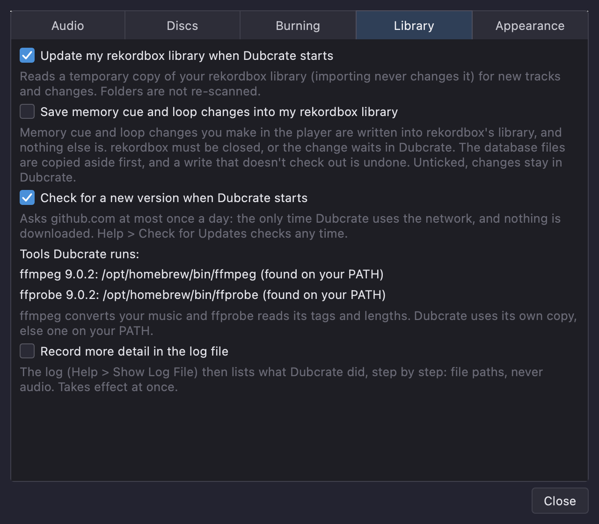

# Dubcrate User Guide

Dubcrate helps you put music from your rekordbox library (or any folder) onto CDs for older players such as the CDJ-1000MK3. You pick tracks, fit them onto discs, preview them, and burn. Track titles show on the player's display.

---

## Contents

- [Getting started](#getting-started)
- [The main window](#the-main-window)
- [Importing your music](#importing-your-music)
- [Browsing and searching](#browsing-and-searching)
- [The Explorer](#the-explorer)
- [Listening to tracks](#listening-to-tracks)
- [Your discs](#your-discs)
- [Burning a disc](#burning-a-disc)
- [Printing labels](#printing-labels)
- [Exporting playlists](#exporting-playlists)
- [Finding a track at a gig](#finding-a-track-at-a-gig)
- [Syncing cues to the card](#syncing-cues-to-the-card)
- [Settings](#settings)
- [Updates, and what Dubcrate sends](#updates-and-what-dubcrate-sends)
- [Keyboard shortcuts](#keyboard-shortcuts)
- [Troubleshooting](#troubleshooting)
- [Good to know](#good-to-know)

---

## Getting started

1. **Import your music.** Choose **File > Import Folder…** for a folder of music, or **File > Import rekordbox Library…** for your rekordbox library.
2. **Find some tracks.** Pick a playlist or folder on the left, or search.
3. **Build a disc.** Choose **Disc > New Disc** (or press the **+** in the Discs list), type a name, then drag tracks onto it. You can also select tracks and press **⌘Return**.
4. **Watch the bar.** It shows how full the disc is. It turns red if the disc is too long.
5. **Burn it.** Open the disc, press **Burn…**, load a blank CD-R and burn.

On Windows and Linux, ⌘ is **Ctrl** and ⇧ is **Shift**. Dubcrate comes with everything it needs to read and burn, so there is nothing else to install.

---

## The main window



- **Library, Explorer and Sync** (left): tabs down the left edge. **Library** is everything you have imported: **All Tracks** first, then your folders and playlists. **Explorer** browses folders and drives without importing ([The Explorer](#the-explorer)). **Sync** is for the CDJ's SD card ([Syncing cues to the card](#syncing-cues-to-the-card)).
- **Tracks** (middle): the tracks of whatever is picked on the left, with a search box above. Right-click a track for **Add to Disc** and **Fit All Shown Tracks to Disc**. When you open a disc, the middle shows that disc instead.
- **Player** (across the top): play, pause, previous, next, the track's title, time, key and BPM, a **cog** for Settings, a **volume knob** (drag it; Shift for fine steps; double-click to reset) and two waveforms.
- **Discs** (right): your discs, filed in folders.

**View > Theme** switches between System, Light, Dark and Macintosh System 6 (black and white, with a bitmap-style font).




**Help > User Guide** opens this guide in its own window (⌘F searches it). **Help > Check for Updates…**, **Help > Third-Party Notices…** and **Help > About Dubcrate** are there too.

---

## Importing your music

| Do this | To |
| --- | --- |
| **File > Import Folder…** (⌘O) | Read a folder of music. Each sub-folder becomes something you can browse. |
| **File > Import rekordbox Library…** (⇧⌘O) | Read your rekordbox library, with its folders and playlists. |
| **File > Import rekordbox XML…** | Read a rekordbox XML file (in rekordbox: File > Export Collection in xml format). You get tracks, playlists and cues, but no waveforms or beat grids. |
| **File > Import rekordbox USB** | Read a rekordbox USB stick: pick one that is plugged in, or **Choose Folder…**. You get tracks, playlists, cues, beat grids and waveforms. |
| **File > Re-import Selected Source** (⇧⌘R) | Bring a source up to date after you add or move music. |
| **File > Remove Selected Source…** | Forget a source. Your music files are not touched. The same two are in the right-click menu of a source in the library list. |

**Your music is never changed, and importing never changes your rekordbox library.** Dubcrate reads a temporary copy of the rekordbox database and only reads your audio files. (The one thing it can write to rekordbox, if you allow it, is the memory cues you edit in the player.) It keeps its own library of track information and your discs.

**Your rekordbox library is kept up to date by itself.** When Dubcrate starts, a splash screen shows while it re-reads a rekordbox library you have already imported. It never imports one on its own, and it doesn't re-scan folders (use ⇧⌘R for those). A track you deleted in rekordbox is removed here too, unless it is on one of your discs: that one is kept and marked, so no disc ever loses a track. Turn this off under **Settings > Library**, or start with `dubcrate-gui --no-import`.

**USB sticks.** The stick needs rekordbox 7's `exportLibrary.db` (in its `PIONEER/rekordbox` folder). Sticks made by older rekordbox versions can't be read yet. A stick is its own source, named after the drive. While it's unplugged, its row in the library list says “(unplugged)” and its tracks are left out of **All Tracks** and the search, so they don't clutter them. Click the stick's own row to see them (greyed out as “File not found”), or right-click and tick **Show Tracks from Unplugged Drives** to bring them back into **All Tracks**. Plug the stick in and they return by themselves. If a stick comes back under a different drive name, Dubcrate knows it's the same one. Memory cues you edit on a stick's tracks stay in Dubcrate. They are never written to the stick.

**XML files** are kept as their own source too. **Re-import Selected Source** reads the file again after you export a new one. Dubcrate's own **Export Playlists** files can be imported this way.

A small badge at the bottom right says whether Dubcrate may write into your rekordbox library: a yellow **Library read-only**, or an orange **Library writable** once you've allowed it.

If Dubcrate can't find your rekordbox library, choose **Choose File…** when it asks and pick `master.db`. It's normally in `~/Library/Pioneer/rekordbox/` on a Mac and `%APPDATA%\Pioneer\rekordbox\` on Windows.

Supported music: MP3, WAV, FLAC, AIFF, AAC/M4A, Ogg, Opus and WMA.

Long jobs (an import, measuring, analysing) show their progress and have a **Cancel** button at the bottom of the window. Cancelling an import changes nothing.

---

## Browsing and searching

- Click a source, playlist or folder on the left to list its tracks.
- The **search box** looks in title, artist, album and genre. **⌘F** jumps to it, **Esc** leaves it (so **Space** plays again) and **Return** leaves it and picks the first track found.
- Click a **column heading** to sort, and click again to reverse. Drag a heading to move a column. Right-click a heading to show or hide columns, or **Reset Columns**. Your layout is remembered. Some columns (Preview, BPM, Key, Time) keep a **fixed width**.
- The dot at the start of a row shows where the track is: **●** on the disc you have open, **○** on another disc, nothing if it's on no disc.

At first you see Title, Artist, BPM, Key, Time, Preview and Genre. **More Columns** adds Album, Year, Rating, My Tags, Label, Remixer, Composer, Comment, Plays, Date Added, Bitrate, Sample Rate, Format and Path. The rekordbox ones (Rating, My Tags, Label, Remixer, Composer, Plays, Date Added) are read at import. Music from a plain folder doesn't have them.

Tracks whose file can't be found are greyed out in the list and red on a disc. Put the file back (or plug the drive in), then re-import the source.

---

## The Explorer

The **Explorer** tab is for music that isn't in an imported library, such as a folder of downloads. Open a folder on the left and its audio files show in the track list, ready to preview, search and add to a disc.



- The tree starts at your **Music** and **home** folders and lists plugged-in **drives**. Drives appear and go by themselves. It never offers the whole system disk. Right-click a folder and choose **Refresh** to list it again.
- Only the files **directly inside** the picked folder show. Open a sub-folder to see its files.
- Tags are only read, never worked out. A file with no BPM or key tag has them blank. A file that is also in rekordbox (same path) uses rekordbox's BPM, key, waveform, beat grid and cues.
- The Explorer's tracks are **not part of your Library** (they aren't in **All Tracks**), but a track you add to a disc stays on it.
- On a Mac, the first time you open Documents, Downloads, Desktop or a drive, macOS may ask if Dubcrate can read it. If you said no, allow it under **System Settings > Privacy & Security > Files & Folders**.

**Pinned folders.** Right-click a folder and choose **Pin Folder** to give it a tab of its own. Drag a pinned tab (or use **Move Up** / **Move Down**) to reorder. **Unpin Folder** removes the tab and touches nothing else.

---

## Listening to tracks

**Double-click** a track to preview it (or drag it onto the player). **Space** plays or pauses, **←** / **→** beat jump and **[** / **]** load the previous or next track, anywhere in the window except a text box. The **Preview** column shows the whole track as a waveform. When a track ends, the next one starts.


- **Left:** previous and next, beat jump back and forward (**‹** **›**) with a menu of how far (1 beat to 32 bars; 4 unless you change it there or in **Settings > Audio**), **CUE**, and play / pause.
- **Middle:** the title, time, key and tempo. Then the **overview** (the whole track; click to jump) and the **detail view** (a scrolling waveform with the beat grid and bar count; zoom with **+**, **RST**, **−** or the wheel). Under them: **hot cue buttons A to H**, **MEMORY**, the loop controls (**AU** automatic, **MA** manual) and **Q** (quantise).
- **Right:** **MEMORY**, **HOT CUE** and **INFO** (cover art, rating, comment, file details). Click a cue row to jump there. A loop's row also turns that loop on.

For rekordbox tracks, the waveform, beat grid, phrases and cues come from rekordbox. For other music Dubcrate draws the waveform itself. **None of this goes on the CD.**

**Scratching.** Drag the detail waveform like a jog wheel and you hear the track move. A playing track carries on when you let go.

**Beat jump** follows the beat grid. A track with no rekordbox grid has no beats to jump by, so its menu is in **seconds** instead.

### Memory cues and loops

rekordbox's hot cues are only shown, never changed. **Memory cues and loops** can be edited. Your changes show in the player, on the Sync tab and on the card.

- **MEMORY** adds a memory cue at the playhead (on the nearest beat if **Q** is on). With a loop on, it saves that loop. A track holds ten cues and loops.
- **✕** deletes the cue or loop at the playhead. In the **MEMORY** tab, each row has its own **✕**. Right-click a row for **Move to Playhead** or **Delete**. Right-click the tab for **Reset to rekordbox's**.
- **Saving into rekordbox.** The first time you edit a rekordbox track, Dubcrate asks if it may save such changes into rekordbox. You can change your mind in **Settings > Library**. If you say yes, only memory cues and loops are written. **rekordbox must be closed.** If it's open, the change waits in Dubcrate and is saved later, or with **File > Save Waiting Memory Cue Edits to rekordbox**. Dubcrate backs up rekordbox's database first and undoes the change if anything looks wrong. **This hasn't been tried on a real library from inside the app yet, so keep your own backup too.**

### Cue point and loops

These help you find your way around a track and **last only until you load another track** (apart from a loop you save with MEMORY).

- **CUE** works like a CDJ's. While playing, it returns to the cue point and stops. Stopped on the cue point, hold it to hear from there. Stopped anywhere else, it sets the cue point.
- **AU:** the number is the loop length in beats (**‹** and **›** halve or double it). Press it to loop from here, and again to leave.
- **MA:** **IN** marks the start, **OUT** marks the end and starts the loop. **RELOOP** leaves a loop, or goes back to the last one.
- **Q:** cue points and loop edges snap to the nearest beat. **It needs a beat grid, which only rekordbox's analysis gives.** Without one, Q is greyed out.

### Waveform looks

**View > Waveform** (or **Settings > Appearance**) chooses **3-Band** (lows blue, mids amber, highs white), **RGB** or **Blue**. System 6 always uses black and white. **Waveform speed** can drop from 60 to 30 FPS on a slower computer.

---

## Your discs

A disc is a playlist that goes on a CD. Discs live in the **Discs** list on the right, filed in folders.


- **Open a disc** by clicking it. It becomes the disc that tracks are **added to** (shown as **Adding to “…”** above the track list).
- **Add tracks** with **⌘Return** or **⌘D**, right-click > **Add to Disc**, or by dragging them onto a disc. **Disc > Fit All Shown Tracks** adds tracks until the disc is full. **Disc > Split Shown Tracks Across Discs…** (⇧⌘D) cuts a long list into as many discs as it takes.
- **New discs and folders:** **Disc > New Disc** / **New Folder**, the **+** at the end of a row, or right-click in the list. The name is ready to type over (**Esc** keeps the suggestion).
- **Rename** by double-clicking a name (or ⌘R). **Duplicate** keeps your edits. **Drag** discs and folders to file them.
- **Delete** with ⌘⌫ or right-click. Nothing you delete here touches your library or music files. Deleting a folder deletes what is in it, at any depth, after a question that says how many.
- A disc that is **too long** has an orange **\*** (hover to see how far over). You can save it but not burn it.
- A disc is just a playlist: **a burned disc is still fully editable**. Dubcrate only remembers *when* it was burned.

**What goes on the CD.** The disc list shows the track **#**, **Time**, and the **Title** and **Artist** written to the disc as CD-TEXT. The CD's own title is the disc's name. **Double-click a title or artist to change what's written on the CD.**

- The edit is for **this disc only**. It never changes your library, the audio file or other discs. Edited text is in *italics* (hover to see the original; clear it to go back).
- Drag rows to reorder. Press **Delete** (or right-click > **Remove from Disc**) to take tracks off. Drag rows onto another disc to move them. Double-click a track's number or time to load it in the player.
- If a disc goes over what a CD holds, you can make it an MP3 CD, **Add Anyway**, or **Cancel**.

**Size and gaps.** New discs are planned for **80 minutes** and are **gapless**. Change either under **Settings > Discs**. A disc keeps the settings it was made with. A CD holds at most **99 tracks**. A length with **~** is an estimate. Exact lengths are measured when you add a track.

**Tracks you already used.** Adding a track that's already on a disc asks first: **Add Anyway**, **Skip Duplicates** or **Cancel**.

### MP3 CDs

A disc is either an **audio CD** (the default; plays anywhere, measured in minutes) or an **MP3 CD** (a data disc of MP3 files, for players that read them such as the CDJ-1000MK3; measured in megabytes, so it holds hours of music, with no 99-track limit). Make one with **Disc > New MP3 Disc** (⇧⌘N), or the **+**, which asks which kind. Right-click > **Make MP3 CD** / **Make Audio CD** switches a disc.

Files on an MP3 disc are always **constant bitrate**. Lossless files become 320 kbit/s MP3s. An MP3 that's already constant bitrate is copied as it is. **Settings > Discs** can lower the top rate. Your title and artist edits go into the files' tags, and files are named `01 Artist - Title.mp3` so players that sort by name keep your order.

An MP3 disc can hold **folders**, listed under it in the Discs list.


- **Make a folder** with the folder button beside the **+**, or right-click > **New Folder on Disc**.
- **Move tracks** by dragging them onto a folder. **Move a folder** by dragging it, or right-click > **Move Folder to**.
- **Limits** (the CDJs'): 999 files per folder, 99 folders, 8 levels deep. Dubcrate stops you at each.

---

## Burning a disc

> **A real burn uses up a blank CD-R.** Use **CD-R**, not CD-RW, which old players read badly.



1. Open the disc and press **Burn…** (or **Disc > Burn Disc…**, ⌘B).
2. Load a blank CD-R. Dubcrate shows the drive and the disc in it. If there's no disc, or it isn't blank, change it and press **Check Again**. With two or more drives, a menu lets you pick one.
3. Check the **Speed**. Slower is safer on old players.
4. Press **Burn**. It stays grey until the drive has a disc that fits. You can't close the window until it finishes.

Dubcrate **won't burn** an empty disc, a disc that's too long, or one with a missing file. The reasons are listed in red. Every track is converted to CD quality (16-bit, 44.1 kHz stereo) with CD-TEXT titles. After a burn, **Print Labels…** appears.

- **Cancel** works while the disc is being prepared and writes nothing. **Once writing starts, you can't stop it.**
- **Levels** (audio CDs): tick **Normalise** to bring every track to about the same loudness. It uses one fixed volume change per track, with no compression. **Loud**, **Club**, **Balanced** and **Gentle** are the choices. A track is never turned up enough to clip. **Peak to full scale** makes each track as loud as it safely can be. MP3 discs and your music files are never changed.
- After an audio burn, Dubcrate reads the disc back to check it matches the plan, then opens the tray.
- **Windows:** burning needs an **administrator account**. **Linux:** if Dubcrate can't use your drive, it says how to get access.

**Export instead of burning.** **Disc > Export Disc as Files…** saves the open disc into a new folder, so you can burn it with another program. An audio CD gives one WAV per track, a `disc.toc` for [cdrdao](https://cdrdao.sourceforge.net), and a `README.txt`. An MP3 CD gives the disc's folder, a `disc.iso` any program can burn, and a `README.txt`.

**Command line.** `dubcrate --help` lists everything. Use the disc number from `dubcrate disc list`:

```
dubcrate burn 1                      # a dry run: checks the disc, burns nothing
dubcrate burn 1 --yes                # really burns
dubcrate export 1 ~/Desktop          # what Export Disc as Files… does
```

---

## Printing labels

Old players have no screen for a track list, so Dubcrate can print one for the case: **index labels** on sticker paper. Choose **Disc > Print Labels…** (⌘P) or right-click a disc. It works for audio CDs and MP3 CDs.

> **Printing has been checked by saving PDFs, not on a real printer yet.** Try **Save PDF…** first, or print on plain paper and hold it against a sticker sheet.



1. **Tick the discs** to print. Ticking a folder ticks its discs.
2. Choose the **Paper** (A3, A4, A5, A6, US Letter or US Legal). Tick **Landscape** to turn it on its side. Type the **Label width** and **Label height** (100 × 50 mm is a good start for a case).
3. **Font size** is **Auto** unless you pick one. **Spread each disc over** says how many labels one disc is divided between. **Columns (up to)** lets a long list run in columns. **Copies of each** repeats every label.
4. **Page margin** keeps clear of the edge your printer can't reach. **Gap between labels** leaves room to cut.
5. Press **Print…** or **Save PDF…**.

Each track shows its number, title and artist (as written on the CD, including your edits), and optionally BPM, key, year and duration. On an MP3 disc, **folders are headings**. A folder is kept together on one label where it can be, or continued with *(cont.)*.

Several discs can share a page. The preview has **◀** and **▶** to turn pages and a **Zoom** box (you can also zoom by **pinching** on a trackpad, or with Ctrl and the wheel). If a list is too long for its label, a red note says what to change. Your choices are remembered.

---

## Exporting playlists

You can hand your discs to other programs as **playlist files**. This only writes new files you choose. It changes nothing in rekordbox.

- **All discs:** **Disc > Export Playlists > All Discs as rekordbox XML…** writes one `.xml` file with every disc as a playlist. **All Discs as M3U…** makes a new **Dubcrate Playlists** folder with one `.m3u8` file per disc.
- **One disc or folder:** right-click it in the Discs list > **Export Playlist** (or **Export Playlists** for a folder).

Playlists list tracks in the order the disc plays them, using the library's own titles and artists, not your CD edits. Tracks whose file is missing are left out, and a message says so. An MP3 disc becomes one flat list.

**Getting it into rekordbox.** In rekordbox, open **Preferences > Advanced > Database** and choose the saved file as the **rekordbox xml** library. Its playlists then appear in the **rekordbox xml** tree in the browser, ready to drag into your own playlists. **This hasn't been tried with rekordbox yet.** If tracks you already have show up twice, please tell us.

**Command line:** `dubcrate export-playlist 1 ~/Desktop/night.xml`, or `dubcrate export-playlists ~/Desktop/discs.xml` for every disc (add `--format m3u` for M3U files).

---

## Finding a track at a gig

With only your CDs, their labels and your phone: **which disc is that track on?** **Disc > Export Track Finder…** saves one web page with every disc and track in it. Open it on your phone, type part of a title or artist, and it lists each disc that has the track. Each card shows the **disc and track number** (and the folder, for an MP3 disc), plus the BPM, key, year, genre and length.

- The page is **one file that works offline**. It sends nothing anywhere. It's a snapshot, so **save a new one after you change your discs**.
- **Exporting reads your music.** A track with no rekordbox analysis is analysed when you export, so the first export of a big collection can take a minute or two. **Cancel** stops it.
- **Search** ignores capitals, accents and apostrophes ("dont stop" finds "Don't Stop"). Every word you type has to match. Only the title and artist are searched.
- Titles and artists are **what's written on the disc**, so they match the printed label.
- **Sort** the results (best match, title, artist, genre, BPM, key, year, length or disc), or press **All tracks** to scroll through everything. Drag along the letters at the right edge to jump through a long list.
- **Filter** (beside the search box) narrows by BPM, year, key and genre. **Compact** fits about twice as many tracks on the screen.
- **Tap a card** to see the track's waveform and its cues as they'll be on the CDJ's card, each with its time and its bar and beat. The page can't play sound.
- **Tagged:** tap the **star** on a track to keep it on a short list. Press **Tagged** to see your picks, and drag the **≡** handle to put them in order. **By disc** groups them under each disc, which is handy at the CD shelf. **Share list** sends the list as text (through your phone's share sheet, or it copies it). Some apps can't keep the list after you close the page; the line under the buttons says if yours does.
- **Related tracks:** tap a card, then **Related tracks** to list tracks on your discs whose BPM is close and whose key mixes, nearest BPM first. Each says what to do on the pitch fader, such as "pitch −3.1%". **Half / double**, **Energy moves** and **Same genre** widen or narrow the list. It can't compare tracks with no BPM or key.

**Getting it onto an iPhone.** A box after the export explains it. **AirDrop the file to the phone**, then tap **Open in Sitecase**. The Files app and Safari only show the page's text, but Sitecase runs it and keeps it, so it works with no signal. **Show in Folder** finds the file. **Help > Track Finder on a Phone…** shows the box again.

The search was used at a gig on an iPhone and worked well. The other parts of the page haven't been tried on a phone yet.

**Command line:** `dubcrate export-finder ~/Desktop/finder.html` (add `--disc 3` for one disc).

---

## Syncing cues to the card

The CDJ-1000MK3 keeps its cues on an **SD card**, one file per disc, and knows a disc by its track layout. So a disc burned with Dubcrate can load with your **rekordbox cues** already set, and each track's **waveform** already drawn. That's what the **Sync** tab is for.

> **Always eject the card before you pull it** (the tab can do it for you). A card pulled too early can be left unreadable by the player. Sync has been tried on a CDJ-1000MK3 (firmware 2.20) with a plain 2 GB SD card.


1. **The card** (left). A plugged-in card appears by itself, with an **eject** button. A blank SD card is listed greyed out, with a **Format…** button. Right-click a card to **Sync**, **Import Cues**, eject it or **Format a Card…**. **Choose Folder…** adds a copy of a card's folder.
2. **Discs to sync** (right). Your audio and MP3 discs, each with a tick box where a sync would write something. A disc's tooltip says what a sync would do: **Not on the card**, **N cues to add**, **In sync**, **No rekordbox cues** or **Can't sync**. Under the list are **Import Cues…**, **Eject after syncing** and **Sync**.
3. **The middle** lists the picked disc's tracks. Click a track to see its waveform as the player's display draws it (100 columns by 7 rows). White will be written, dimmer is already on the card, dashed isn't analysed yet. Small red dashes are the track's cues.



When you press **Sync**, Dubcrate asks first, copies the card's files to a `card-backups` folder next to your library, writes, and reads everything back to check.

- **Every rekordbox cue becomes a memory cue** on the card. Loops become memory loops. The player's own three hot cue buttons are never touched.
- **What's already on the card is kept.** Cues are only added, and duplicates are skipped. The player holds 100 cues per disc.
- **A track that already has a waveform keeps it.** Tracks without one are analysed first.
- **Cues land where the sound is.** rekordbox times an MP3 from the start of its file, but a CD leaves out a short silent start, so a rekordbox time can be up to about 50 ms late. Dubcrate moves each cue earlier to match.

**MP3 discs** sync the same way. A disc Dubcrate burned is recognised even if the player hasn't loaded it yet. For a disc burned elsewhere, play it in the player once first, or right-click it in the Discs list and choose **Disc ID…** to tell Dubcrate how it was burned. The player can't take folders inside folders yet.



**Bringing changes back.** **Import Cues…** lists what you set on the player that Dubcrate doesn't have. Untick what you don't want, then press **Import**. New cues and loops become memory cues and loops in Dubcrate (and in rekordbox, if you've allowed that). The player's hot cues are listed but **not ticked**. Cues you deleted or moved on the player are noticed from the sync after this one, for audio and MP3 discs alike. **This hasn't been tried with cues set on a real player yet.**

**If a copy of a disc doesn't match.** A drive can lay a burned disc out slightly differently from the plan, so two copies of one playlist can differ. After a burn, Dubcrate keeps what the disc really has. For a disc burned earlier or elsewhere, right-click it and choose **TOC Manager…**, put the disc in the drive and press **Read from Disc in Drive**.

### Setting up a blank card

**Format a Card…** (right-click the card list, or **Format…** beside a blank card) erases a blank SD card and sets it up the way the player expects, so you can sync at home.


- **Only plain SD cards of 2 GB or less.** The CDJ-1000MK3 can't read SDHC or SDXC cards. Other disks are greyed out with the reason.
- **It only erases a card.** Only removable disks are listed, and you must tick that you understand everything on it will be erased.
- Tried on Linux and Windows, and the player accepted the card. Not yet tried on a Mac. If the player says *UNFORMAT* or *CARD ERROR*, format the card once in the player.

---

## Settings

**File > Settings…** (⌘,) has five tabs:





- **Audio:** the **Output device**, **Buffer size** (raise it if a preview crackles) and **Beat jump** distance.
- **Discs:** the **Default CD-R size** for new discs (80 minutes (700 MB) or 74 minutes (650 MB)), **Between tracks** (**Gapless**, or 1 to 3 seconds) and **MP3 CDs: highest rate**.
- **Burning:** the **Burn speed** a burn starts with (10x unless you change it), and whether it starts with **Normalise** on.
- **Library:** whether Dubcrate updates your rekordbox library at start-up, whether memory cue and loop changes are saved into rekordbox, whether it checks for a new version, the tools it found, and **Verbose logging**.
- **Appearance:** **Theme**, **Waveform style**, **Waveform background**, **Waveform speed** (60 or 30 FPS), **Key notation** (Camelot or Musical) and **Units** (millimetres, centimetres or inches).

---

## Updates, and what Dubcrate sends

Dubcrate checks for a newer version when it starts, at most once a day, and tells you only if there is one. The notice shows the release notes and **View Release…**. **Skip This Version** silences it for that version. **Remind Me Later** leaves it until tomorrow. A blue **Update available** button stays next to the version at the bottom left. Dubcrate doesn't download or install anything itself.

**Help > Check for Updates…** checks straight away. Turn off the start-up check under **Settings > Library**.

This is the only time Dubcrate uses the network. It asks `github.com` for the list of releases and sends nothing about you or your music.

---

## Keyboard shortcuts

**Help > Keyboard Shortcuts** (⌘/) opens the full, searchable list. The main ones (on Windows and Linux, ⌘ is Ctrl):

| Shortcut | Does |
| --- | --- |
| Double-click a track | Preview it |
| Space | Play or pause (anywhere except a text box) |
| Return | Load the highlighted track into the player |
| ⌘Return, or ⌘D | Add the selected tracks to the disc |
| ← / → | Beat jump back / forward |
| [ / ] | Previous / next track |
| Delete | Take the selected tracks off the disc |
| ⌘O / ⇧⌘O | Import a folder / a rekordbox library |
| ⌘R / ⇧⌘R | Rename the picked disc or folder / re-import the source |
| ⌘⌫ | Delete the picked disc or folder |
| ⌘N / ⇧⌘N | New disc / New MP3 disc |
| ⌘B | Burn the disc |
| ⌘P | Print labels |
| ⇧⌘D | Split the shown tracks across discs |
| ⌘F | Find tracks (Esc leaves the box; ⌘F in the guide finds in the guide) |
| ⌘, | Settings |
| ⌘/ | Show this list |

---

## Troubleshooting

- **A preview crackles, or there's no sound.** Raise the buffer size, or choose the output device, in **Settings > Audio**.
- **Dubcrate can't find ffmpeg.** The download includes it, so the app has been damaged: download it again. **Settings > Library** shows what it found.
- **New tracks from rekordbox aren't showing.** Select the rekordbox source and press ⇧⌘R.
- **A track is greyed out, or "no longer in its source".** The file moved, the drive is unplugged, or it left the source and is only kept because a disc uses it. Reconnect and re-import, or take it off the disc.
- **The Burn button is grey.** Read the red lines in the burn window: the disc may be empty, too long or missing a file, or the drive has no suitable disc (press **Check Again**).
- **A disc is over its size.** Take tracks off, split the playlist, or make it an MP3 CD.
- **An MP3 CD won't play, or its tracks are in the wrong order.** Not every player reads MP3 discs, and old ones can be fussy about file names and speed. Burn a test disc slowly.
- **Something went wrong.** Unexpected errors show a **Something went wrong** message with **Show Log File**. **Help > Show Log File** opens the folder with the log files (they list file paths and what Dubcrate did, never your audio). Attach them to a report. Tick **Verbose logging** in **Settings > Library** for more detail.

---

## Good to know

- **Titles use CD-TEXT**, which handles Western European letters. Others are simplified, or become a question mark.
- **A disc holds only audio and titles.** Cue points, beat grids and analysis can't go on an audio CD. That's what Sync is for. Everything is converted to 16-bit, 44.1 kHz when burned.
- **Scrolling never changes a control by accident.** Click a number box, drop-down or slider first and it will answer the wheel. **Number boxes work like knobs:** drag up or down (Shift for fine steps), or click once and type.
- **What has been tried on real gear.** Burning audio CDs on Mac, Windows and Linux, and MP3 CDs on Windows and Linux, all played on a CDJ-1000MK3. Syncing cues and waveforms to the SD card. Memory cue writing into rekordbox from the command line. **Not yet tried:** loudness matching on a player, printing on a real printer, Import Cues with cues set on a real player, and Windows 10.
- Dubcrate keeps its library in `~/Library/Application Support/Dubcrate/` on a Mac, `%LOCALAPPDATA%\Dubcrate\` on Windows and `~/.local/share/Dubcrate/` on Linux.
- Dubcrate is free software under the GNU General Public License, version 3 or later. It isn't affiliated with Apple, AlphaTheta or Pioneer DJ. rekordbox, CDJ and Pioneer DJ are trademarks of their owners.
