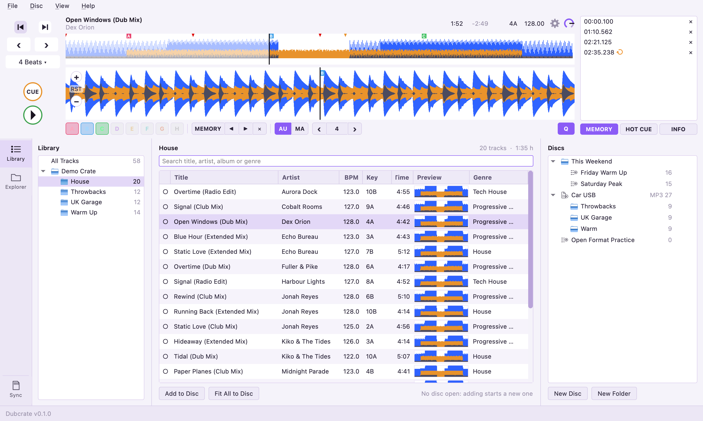
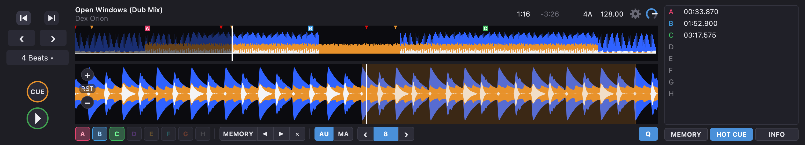
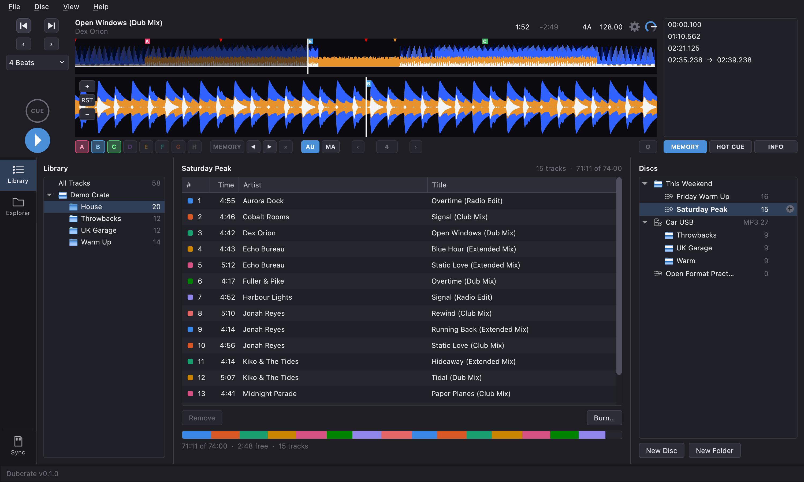
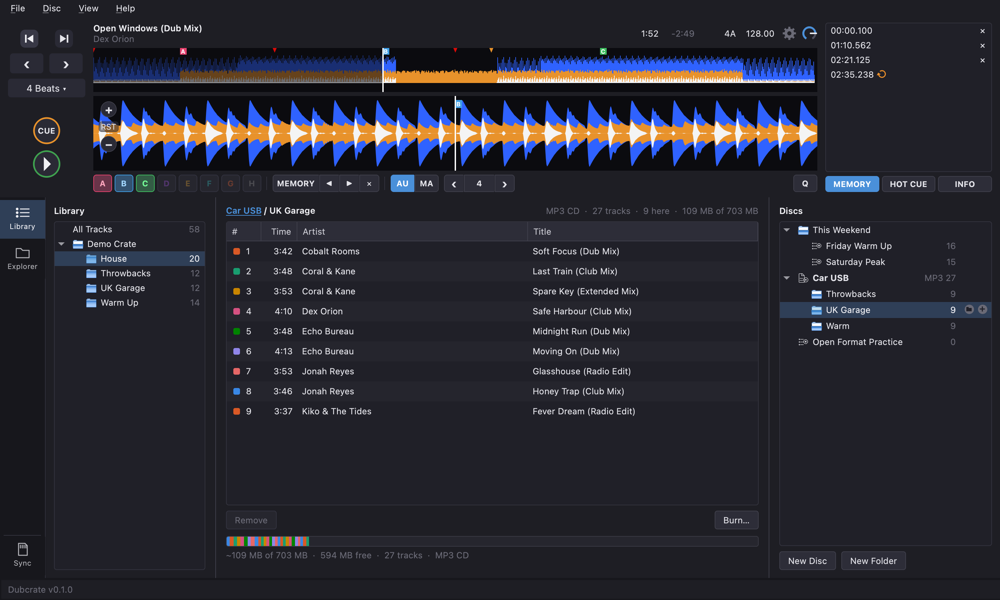
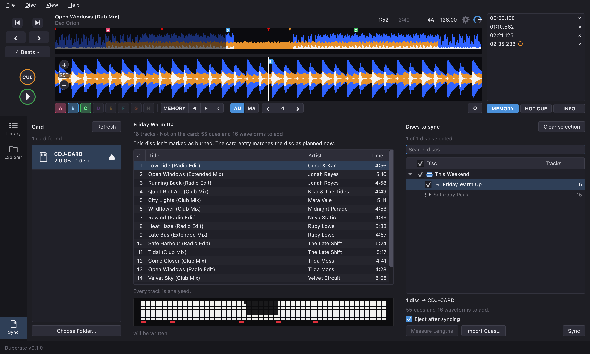
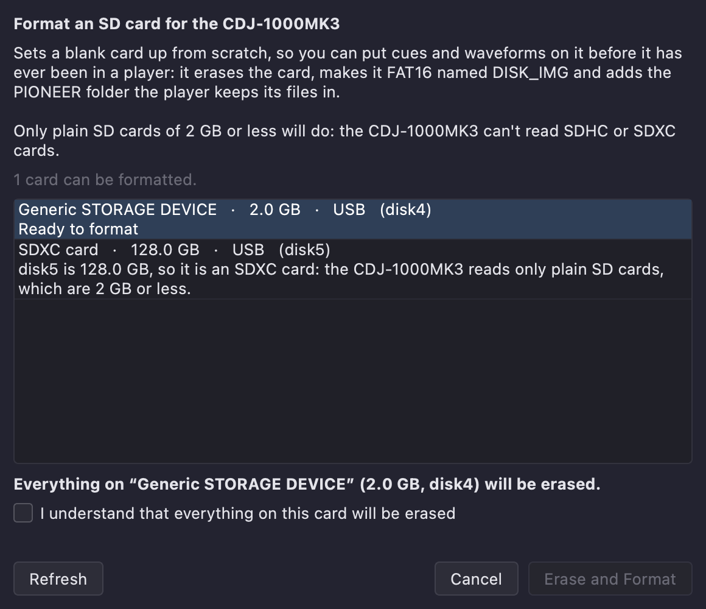

# Dubcrate User Guide

Dubcrate helps you put music from your rekordbox library (or any folder) onto audio CDs for older players such as the CDJ-1000MK3. You pick tracks, plan discs that fit exactly, preview them with waveforms, and burn CDs whose track titles show on the player's display.

> **Burning from the window is new.** It has been tried with a stand-in burner but not yet on a real drive. The command line is the route that has been proven: see [Burning a disc](#burning-a-disc).

---

## Contents

- [Getting started](#getting-started)
- [The main window](#the-main-window)
- [Importing your music](#importing-your-music)
- [Browsing and searching](#browsing-and-searching)
- [The Explorer](#the-explorer)
- [Listening to tracks](#listening-to-tracks)
- [Your discs](#your-discs)
- [Burning a disc](#burning-a-disc)
- [Printing labels](#printing-labels)
- [Exporting playlists](#exporting-playlists)
- [Finding a track at a gig](#finding-a-track-at-a-gig)
- [Syncing cues to the card](#syncing-cues-to-the-card)
- [Settings](#settings)
- [Updates, and what Dubcrate sends](#updates-and-what-dubcrate-sends)
- [Keyboard shortcuts](#keyboard-shortcuts)
- [Troubleshooting](#troubleshooting)
- [Good to know](#good-to-know)

---

## Getting started

1. **Import your music.** Choose **File > Import Folder…** for a folder of music, or **File > Import rekordbox Library…** for your rekordbox library.
2. **Find some tracks.** Pick a playlist or folder on the left, or search.
3. **Build a disc.** Choose **Disc > New Disc** (or press the **+** in the Discs list), type a name, then drag tracks onto it, or select them and press **⌘Return**.
4. **Watch the bar.** It shows how full the disc is and turns red if the disc is too long.
5. **Burn it.** Open the disc, press **Burn…**, load a blank CD-R and burn.

Dubcrate includes **ffmpeg** and **ffprobe**, which it uses to read tracks and prepare them for the disc, so there is nothing to install.

---

## The main window


- **Library, Explorer and Sync** (left): tabs down the left edge. **Library** is everything you have imported: **All Tracks** first, then your folders and playlists, as in rekordbox. **Explorer** browses folders and drives without importing ([The Explorer](#the-explorer)). **Sync** is for the CDJ's SD card ([Syncing cues to the card](#syncing-cues-to-the-card)).
- **Tracks** (middle): the tracks of whatever is selected on the left, with a search box above. Right-click a track for **Add to Disc** and **Fit All Shown Tracks to Disc**. When you open a disc, the middle shows that disc instead.
- **Player** (across the top): play and pause, previous and next, the title, time, key and BPM of the track you are previewing, a **cog** that opens Settings, a **volume knob** (drag it; Shift for fine steps; double-click to reset), and two waveforms.
- **Discs** (right): your burn playlists, filed in folders.

**View > Theme** switches between System, Light, Dark and Macintosh System 6 (black and white, with a bitmap-style font).




**Help > User Guide** opens this guide in its own window (⌘F searches it). **Help > Check for Updates…**, **Help > Third-Party Notices…** and **Help > About Dubcrate** are there too.

---

## Importing your music

| Do this | To |
| --- | --- |
| **File > Import Folder…** (⌘O) | Read a folder of music. Each sub-folder becomes something you can browse. |
| **File > Import rekordbox Library…** (⇧⌘O) | Read your rekordbox library, with its folders and playlists. |
| **File > Re-import Selected Source** (⇧⌘R) | Bring a source up to date after you added or moved music. |
| **File > Remove Selected Source…** | Forget a source. Your music files are not touched. |

**Your music is never changed, and importing never changes your rekordbox library.** Dubcrate reads a temporary copy of the rekordbox database and only reads your audio files. (The one thing it can write to rekordbox, if you allow it, is the memory cues you edit in the player.) It keeps its own library of track information and your discs.

**A rekordbox library is kept up to date by itself.** Each time Dubcrate starts, a splash screen shows while it re-reads a rekordbox library you have already imported. It never imports one on its own, and it doesn't re-scan folders (use ⇧⌘R for those). A track you deleted in rekordbox is removed here too, unless it is on one of your discs: that one is kept and marked, so no disc ever silently loses a track. Turn this off under **Settings > Library**, or start with `dubcrate-gui --no-import`.

A small badge at the bottom right of the status bar says whether Dubcrate may write into your rekordbox library: a yellow **Library read-only** or, once you have allowed it, an orange **Library writable**.

If Dubcrate can't find your rekordbox library, choose **Choose File…** when it asks and pick `master.db` (normally in `~/Library/Pioneer/rekordbox/` on a Mac and `%APPDATA%\Pioneer\rekordbox\` on Windows). Version 7 is the one it has been tried with.

Supported music: MP3, WAV, FLAC, AIFF, AAC/M4A, Ogg, Opus and WMA.

Long jobs (an import, measuring lengths or levels, analysing waveforms) show their progress and have a **Cancel** button at the bottom of the window. Cancelling an import changes nothing; for the others, what was worked out is kept.

---

## Browsing and searching

- Click a source, playlist or folder on the left to list its tracks.
- The **search box** filters by title, artist, album or genre. **⌘F** jumps to it, **Esc** steps out of it (so **Space** plays again) and **Return** steps out and picks the first track found.
- Click a **column heading** to sort, and click again to reverse. Drag a heading to reorder columns, and right-click one to show or hide columns or **Reset Columns**. Your layout is remembered. Some columns (the marker, Preview, BPM, Key, Time) keep a **fixed width**.
- The dot at the start of a row shows where the track is: **●** on the disc you have open, **○** on another disc, nothing if it is on no disc.

Only Title, Artist, BPM, Key, Time, Preview and Genre show at first. **More Columns** adds Album, Year, Rating, My Tags, Label, Remixer, Composer, Comment, Plays, Date Added, Bitrate, Sample Rate, Format and Path. The rekordbox ones (Rating, My Tags, Label, Remixer, Composer, Plays, Date Added) are read at import, so re-import once after updating Dubcrate to fill in new ones. Music from a folder has none of them.

Tracks whose file can't be found are greyed out in the list and red on a disc. Reconnect the drive or put the file back, then re-import the source.

---

## The Explorer

The **Explorer** tab is for music that isn't in an imported library: a folder of downloads, or a USB stick. Open folders on the left and click one, and the audio files directly inside it appear in the track list, ready to preview, sort, search and add to a disc.


- The tree starts at your **Music** and **home** folders and lists plugged-in **drives** (a drive appears or goes by itself). It never offers the whole system disk. Right-click a folder and choose **Refresh** to list it again.
- Only the files **directly inside** the picked folder show; open a sub-folder to see its files.
- Tags are only read, never worked out: a file with no BPM or key tag has them blank. **A file that is also in rekordbox** (the same path) uses rekordbox's BPM, key, waveform, beat grid and cues.
- The Explorer's tracks are **not part of your Library** (they aren't in **All Tracks**), but a track you add to a disc is kept on it.
- On a Mac, the first time you open Documents, Downloads, Desktop or a drive, macOS may ask whether Dubcrate may read it. If you said no, allow it under **System Settings > Privacy & Security > Files & Folders**.

**Pinned folders.** Right-click a folder and choose **Pin Folder** to give it a tab of its own below Explorer. The tab lists the folders inside it, and its own files show when you open it (or click the empty space under the list). Drag a pinned tab, or use **Move Up** / **Move Down**, to reorder; **Unpin Folder** removes the tab and touches nothing else.

---

## Listening to tracks

**Double-click** a track to preview it (or drag it onto the player). **Space** plays or pauses, **←** / **→** beat jump and **[** / **]** load the previous / next track, wherever you are in the window except in a text box. The **Preview** column shows the whole track as a waveform. When a track ends, the next one in the list or open disc starts, skipping missing files.



- **Left:** previous and next track, beat jump back and forward (**‹** **›**) with a menu of how far (1 beat to 32 bars; 4 unless you change it there or in **Settings > Audio**), **CUE** and play / pause.
- **Middle:** the title, time, key and tempo, the **overview** (whole track, with rekordbox's phrases and cues; click to jump) and the zoomed **detail view** (a fixed playhead over a scrolling waveform with the beat grid and the **bar and beat** count; zoom with **+**, **RST**, **−** or the wheel). Under them are the **hot cue buttons A to H**, **MEMORY**, the loop controls (**AU** automatic, **MA** manual) and **Q** (quantise).
- **Right:** **MEMORY** (memory cues and loops), **HOT CUE** (A to H) and **INFO** (cover art, rating, comment and file details). Click a cue row, or a lit hot cue button, to jump there. A loop's row also turns that loop on.

For rekordbox tracks the waveforms, beat grid and phrases come from rekordbox's own analysis and the cues from its library. For other music Dubcrate draws the waveform itself. **None of this goes on the CD.**

**Scratching.** Drag the zoomed waveform as you would a jog wheel; you hear the track move with it. A playing track carries on from where you let go.

**Beat jump** keeps its place within the beat and follows the beat grid. A track with no grid or tempo jumps a fixed 2 seconds.

### Memory cues and loops

**rekordbox's hot cues are only shown, never changed.** Memory cues and loops can be edited, and the changes show in the player, on the Sync tab and on the card.

- **MEMORY** adds a memory cue at the playhead (on the nearest beat if **Q** is on). With a loop on, it **saves that loop** as a memory loop (marked with a small orange loop mark). A track holds ten cues and loops together.
- **✕** deletes the cue or loop at the playhead. In the **MEMORY** tab, each row has its own **✕**, and right-click gives **Move to Playhead** (cues only) and **Delete**. Right-click the tab for **Reset to rekordbox's**, which forgets your changes to that track.
- **Saving into rekordbox.** The first time you edit a rekordbox track, Dubcrate asks whether to save such changes to rekordbox (change it any time in **Settings > Library**). With it on they are written into rekordbox's library, and nothing else is. **rekordbox must be closed**: if it is open the change waits in Dubcrate and is saved with your next edit of that track, or with **File > Save Waiting Memory Cue Edits to rekordbox** (only in the menu while something waits). Before the first save of a session Dubcrate copies rekordbox's database files to a `rekordbox-backups` folder next to its library, checks what it wrote and undoes it if anything is wrong. Keep your own backup too.

### Cue point and loops

These are for finding your way round a track and **last only until another track is loaded** (apart from a loop you save with MEMORY).

- **CUE** works like a CDJ's: while playing, it goes back to the cue point and stops. Stopped on the cue point, **hold CUE** to hear it from there. Stopped anywhere else, it sets the cue point.
- **AU**: the number is the loop length in beats (**‹** and **›** halve or double it). Press the number to loop from where the track is; press it again to leave. This needs a beat grid or tempo.
- **MA**: **IN** marks the start, **OUT** marks the end and starts the loop. **RELOOP** leaves a loop, or returns to the last one.
- **Q**: cue points and loop edges land on the nearest beat. It is on the first time you run Dubcrate and stays as you leave it.

### Waveform looks

**View > Waveform** (or **Settings > Appearance**) chooses **3-Band** (rekordbox's default: lows blue, mids amber, highs white), **RGB** or **Blue**. System 6 always uses black-and-white 3-Band. **Waveform background** can keep rekordbox's dark look in any theme, and **Waveform speed** can drop from 60 to 30 FPS on a slower computer.

---

## Your discs

A disc is a playlist that goes on a CD. Discs live in the **Discs** list on the right, filed in folders.



- **Open a disc** by clicking it. It becomes the disc tracks are **added to** (shown as **Adding to “…”** above the track list).
- **Add tracks** with **⌘Return** or **⌘D**, right-click > **Add to Disc**, or by dragging them onto any disc in the list. **Disc > Fit All Shown Tracks** adds every track shown until the disc is full. **Disc > Split Shown Tracks Across Discs…** (⇧⌘D) cuts a long list into as many discs as it takes.
- **New discs and folders:** **Disc > New Disc** / **New Folder**, the **+** at the end of a row, or right-click in the list. The name is ready to type over (**Esc** keeps the suggestion). A new disc goes in the folder or beside the disc you picked.
- **Rename** by double-clicking a name (or ⌘R). **Duplicate** keeps edits. **Drag** discs and folders to file them.
- **Delete** with ⌘⌫ or right-click. Nothing you delete here touches your library or music files. **Deleting a folder deletes what is in it**, at any depth, after a question that says how many.
- A disc that is **too long** is marked with an orange **\*** (hover for how far over). It can be saved but not burned.
- A disc is just a playlist: **a burned disc is still fully editable**. Dubcrate only remembers *when* it was burned.

**What goes on the CD.** The disc list shows the track **#**, **Time**, and the **Title** and **Artist** written to the disc as CD-TEXT. The CD's own title is the disc's name. **Double-click a title or artist to change what is written on the CD**:

- The edit is for **this disc only**; it never changes your library, the audio file or other discs. Edited text is in *italics* (hover to see the original; clear it to go back).
- Drag rows to reorder, and press **Delete** (or right-click > **Remove from Disc**) to take tracks off. Drag rows onto another disc in the Discs list to **move** them there (their edited text goes with them). Double-click a track's number or time, or press **Return** on it, to load it in the player. If a disc goes over what a CD holds, you can make it an MP3 CD, **Add Anyway**, or **Cancel** to take the addition back.

**Size and gaps.** New discs are planned for **80 minutes** and are **gapless**. Change either under **Settings > Discs**; a disc keeps what it was made with. When you burn, the disc in the drive is what counts. The capacity bar shows each track as a block, with time used and left. A CD holds at most **99 tracks**. A length with **~** is an estimate; exact lengths are measured when you add a track and again when the disc is prepared.

**Tracks you already used.** Adding a track that is already on this or another disc asks first: **Add Anyway**, **Skip Duplicates** or **Cancel**. The same file counts as one track even if it is in rekordbox and in an Explorer folder.

### MP3 CDs

A disc is an **audio CD** (default; plays anywhere, measured in minutes) or an **MP3 CD** (a data disc of MP3 files for players that read them, such as the CDJ-1000MK3; measured in megabytes, so it holds hours of music, with no 99-track limit). Make one with **Disc > New MP3 Disc** (⇧⌘N), or the **+**, which asks which kind. Right-click > **Make MP3 CD** / **Make Audio CD** switches a disc (its tracks stay). If an audio CD goes over its length, Dubcrate offers to make it an MP3 CD.

Files on an MP3 disc are always **constant bitrate**: lossless files become 320 kbit/s MP3s, an MP3 that is already constant bitrate is copied as it is, and a lossy file below 320 keeps its own rate. **Settings > Discs** can lower the top rate. Artist and title edits are written into the files' tags, and files are named `01 Artist - Title.mp3` so players that sort by name keep your order.

An MP3 disc can hold **folders**, listed under it in the Discs list. Click a folder to see and edit its tracks, or a step in the path above the tracks to go back up.



- **Make a folder** with the folder button beside the **+** (inside the one you picked), or right-click > **New Folder on Disc** / **New Folder Inside**.
- **Move tracks** by dragging them onto a folder (or right-click > **Move to Folder**). **Move a folder** by dragging it, or right-click > **Move Folder to**.
- **Limits** (the CDJs'): 999 files per folder, 99 folders, 8 levels. Dubcrate stops you at each. Making a disc an audio CD removes its folders, after asking.

---

## Burning a disc

> **A real burn uses up a blank CD-R.** Use **CD-R**, not CD-RW, which old players read badly.


1. Open the disc and press **Burn…** (or **Disc > Burn Disc…**, ⌘B).
2. Load a blank CD-R. Dubcrate shows the drive, whether the disc is blank, and how much it holds. If there is no disc, or it isn't blank, change it and press **Check Again**. With two or more drives, a menu lets you pick one (remembered); a burn on a drive other than the first isn't checked afterwards.
3. Check the **Speed** (it starts at your **Settings > Burning** default; slower is more reliable on old players).
4. Press **Burn**. It stays grey until the drive has a disc that fits, and Return never starts a burn. The window can't be closed until it finishes.

Dubcrate **won't burn** an empty disc, one longer than the disc in the drive, or one with a missing file; the reasons are listed in red. Every track is converted to CD quality (16-bit, 44.1 kHz stereo) with CD-TEXT titles. After a burn the disc is marked as burned, and **Print Labels…** appears.

- **Cancel** shows while the disc is prepared (or an export is made) and stops at once, writing nothing. **Once writing starts there is no Cancel.** After a failed or cancelled burn, Dubcrate looks at the drive again before you can burn once more.
- **Levels** (audio CDs): tick **Normalise** to give each track one fixed volume change, with no compression or limiting. **Loud** (-9), **Club** (-10), **Balanced** (-12) and **Gentle** (-14) bring tracks to about the same loudness; a track is never turned up enough to clip, and ones that can't reach the target are counted as **held back**. **Peak to full scale** instead makes each track as loud as it safely can be. The first measuring takes a moment (it is remembered). MP3 discs and your music files are never changed.
- After a real audio burn Dubcrate reads the disc's table of contents back to check it matches the plan (the log says so), then opens the tray. Syncing cues relies on that match. The check is new and hasn't run on a real burn yet.

**Export instead of burning.** **Disc > Export Disc as Files…** writes the open disc into a new folder inside one you choose, so you can burn it with another program. An **audio CD** gives one WAV per track, a `disc.toc` for the free program [cdrdao](https://cdrdao.sourceforge.net), and a `README.txt` with the commands. An **MP3 CD** gives the disc's folder, a `disc.iso` any program can burn, and a `README.txt`. On a computer that can't burn from Dubcrate (Linux without `cdrdao`; Windows isn't supported yet), this is the way to get a disc.

**Command line.** Put the disc number from `dubcrate disc list` in place of `1`:

```
dubcrate burn 1                      # a dry run: checks the disc and burns nothing
dubcrate burn 1 --yes --simulate     # a laser-off test write, with a disc in the drive
dubcrate burn 1 --yes                # really burns
dubcrate export 1 ~/Desktop          # what Export Disc as Files… does
```

`--speed` sets the speed (default 10x), and `--levels match` (with `--target -10`) or `--levels peak` normalises. The full list of options is in the project's developer notes.

---

## Printing labels

Old players have no screen for a track list, so Dubcrate can print one for the case: **index labels** on sticker paper in your ordinary printer. Choose **Disc > Print Labels…** (⌘P) or right-click a disc. It works for audio CDs and MP3 CDs.

> **Printing has been checked by saving PDFs, not yet on a real printer.** Try **Save PDF…** first, or print on plain paper and hold it against a sticker sheet.


1. **Tick the discs** to print (ticking a folder ticks its discs; **All** and **None** help). Each label is headed with the disc's name and its folders.
2. Choose the **Paper** (A3, A4, A5, A6, US Letter or US Legal), tick **Landscape** to turn it on its side (wide labels then fit more to a sheet, which saves paper), and type the **Label width** and **Label height**, in the unit set under **Settings > Appearance > Units**. 100 × 50 mm is a good start for a case.
3. **Font size** is **Auto** (as large as fits) unless you pick a size. **Spread each disc over** says how many labels one disc is divided between (**Auto** uses the fewest that stay readable). **Columns (up to)** lets a long list run in columns. **Copies of each** repeats every label.
4. **Page margin** keeps clear of the edge your printer can't reach; **Gap between labels** leaves room to cut. **Draw a thin outline to cut along** can be turned off.
5. Press **Print…** or **Save PDF…**.

Each track shows its **number**, **title** and **artist** (as written on the CD, including your edits), and optionally **BPM**, **key**, **year** and **duration** (BPM and key start ticked; BPM, key and year come from rekordbox or the file's tags, so a plain-folder track may have none). On an MP3 disc, **folders are headings**; a folder is kept together on one label where readable, else continued under the same heading with *(cont.)*.

Labels from every ticked disc are laid out one after another, so **several discs share a page**. The preview has **◀** and **▶** to turn pages, and a **Zoom** box (also **pinching** on a trackpad, or Ctrl and the wheel). If a list is too long for the label, a red note says which disc and what to change. Your choices are remembered.

---

## Exporting playlists

Your discs are playlists, and you can hand them to other programs as **playlist files**, for example to see a burn list in rekordbox. This only writes new files you choose: **nothing in rekordbox is read back or changed**, and no music file is touched.

- **All discs:** **Disc > Export Playlists > All Discs as rekordbox XML…** writes one `.xml` file with every disc as a playlist, your disc folders as playlist folders. **All Discs as M3U…** makes a new folder, **Dubcrate Playlists**, inside one you choose, with one `.m3u8` file per disc (and a folder for each of your disc folders), since M3U has neither folders nor several playlists in one file.
- **One disc or one folder:** right-click it in the Discs list > **Export Playlist** (a disc) or **Export Playlists** (a folder) > **rekordbox XML…** or **M3U…**.

Each playlist lists the tracks in the order the disc plays. An MP3 disc becomes one flat list: the files in the root first, then each folder in turn. The titles and artists are the **library's own**, not the ones you edited for the CD, and each file is named by its full path so rekordbox can match a track it already has. A track whose file is missing is left out, and a message says which. A disc with nothing left to list is skipped.

**Getting it into rekordbox.** Use rekordbox's own XML import: in its **Preferences > Advanced > Database**, choose the file saved here as the **rekordbox xml** library, then open the **rekordbox xml** tree in the browser: the playlists are listed there and can be dragged into your own playlists. **This hasn't been tried with rekordbox yet**, and its menu names may differ between versions. If tracks you already have show up twice, please say so.

**Command line:**

```
dubcrate export-playlist 1 ~/Desktop/night.xml                     # one disc
dubcrate export-playlist 1 ~/Desktop/night.m3u8 --format m3u
dubcrate export-playlists ~/Desktop/discs.xml                      # every disc
dubcrate export-playlists ~/Desktop --format m3u                   # a new folder of M3U files in ~/Desktop
```

---

## Finding a track at a gig

With only the CDs, their printed labels and your phone, **which disc is that track on?** **Disc > Export Track Finder…** saves one web page with every disc and track in it. Open it on your phone, type part of a title or artist, and it lists each disc that has the track, with the **disc and track number** on the bottom line of each card (an MP3 disc also shows the folder), and the track's **BPM, key, year, genre and length** under the artist when known.

- **Exporting analyses waveforms.** A track that has no rekordbox analysis and no kept waveform is analysed from its audio file when you export (the status bar shows progress, and **Cancel** stops it; what was done is kept). That can take a minute or two the first time for a big collection, and later exports are quick. If a file can't be read, or a track still has no waveform, a message after the export says how many. Dubcrate only reads your music and rekordbox; nothing is changed.
- The page is **one file that works offline**: it needs no signal and sends nothing anywhere. It is a snapshot, so **save a new one after you change your discs** (the page says on its first screen when it was made).
- Search ignores capital letters, accents and apostrophes ("dont stop" finds "Don't Stop"), and every word you type has to match. Only the title and artist are searched (not the genre or BPM). By default the best matches come first: tracks where a word starts with what you typed, ahead of ones that only contain it.
- The title and artist are **what is written on the disc** (including anything you edited for the CD), so they match the printed label. BPM, key, year and genre are the library's. Keys follow **Settings > Appearance > Key notation**. Every disc is included, whether or not it has been burned.
- **To fit more on a small screen**, a long title shows two lines and the artist and info one line each: **tap a card** to see all of it, and tap again to fold it. **Filter > Compact** runs the title and artist together on one line and hides the info line (tap a card to see it), so about twice as many tracks fit; the choice is kept on the phone. The title "Dubcrate Track Finder" scrolls away, and the search box and buttons slide out of the way as you scroll down and come back as soon as you scroll up.
- **To jump through a long list**, drag a finger down the strip of letters along the right edge: the list jumps to that letter, with a big letter shown while you hold. It follows the sort (letters for title and artist, BPM tens, keys, years), and only shows while a list is on screen, not in Tagged. If it gets in the way, **Filter > Letter strip** switches it off; the choice is kept on the phone.
- **To order the results**, use the **Sort** menu under the buttons, for a search as much as for the whole list: best match, title, artist, genre, BPM, key, year, length or disc. The arrow beside it reverses the order, a track with nothing for that column goes last, and the list gets a heading for each letter (or genre, key, year, disc). With nothing typed, best match means by title.
- **To scroll through everything**, press **All tracks**. It clears the search box and lists every track in your chosen order. Typing again goes back to searching (it leaves All tracks), and any filters you set still apply. Press **All tracks** again to go back to search.
- **To see a track's waveform and cues**, tap its card: the whole track is drawn in the same three colours as the player, with a faint line and a label at every minute under it, and a **numbered red flag** at each cue. Under the waveform each cue has a button with its **number, its time, its hot cue letter (if it is one) and its bar and beat**, then its name if you gave it one; tap a button, or tap anywhere on the waveform, to read the time at that spot (a tap near a flag jumps to it). A track with neither waveform nor cues says so. The cues are what the CDJ's SD card will have after a sync: rekordbox's **memory cues and hot cues** (the card keeps every hot cue as a memory cue), with any memory cues you changed in Dubcrate laid over. The **bar and beat** ("17.1" is bar 17, beat 1) are those of the nearest beat in rekordbox's beat grid, counted as the player counts them; a **≈** in front means the cue is clearly off the beat (more than 40 ms), and tapping it says by how much. A track with no rekordbox beat grid (a plain folder track) shows times only. A cue that came from a **hot cue** shows its letter (A to H) in its button before the bar and beat, and a hot cue and a memory cue at the same spot are one cue, as on the card. Loops are not shown. The page can't play sound; it is for looking.
- **To save tracks to play later**, tap the **star** on a track, then press **Tagged** to see your picks in the order you tagged them. **Clear** (it appears beside Tagged) empties the list: the first tap asks "Tap again to clear 7", and the question goes away by itself after a few seconds. Tap a star again to remove a track (it stays on the list, dimmed, until you leave and come back, so a slip is one tap to undo). Typing in the search box takes you back to search. The tags are kept in the page on your phone, and a newer export keeps them for the same disc, folder, track number and title. **Some apps can't keep them after you close the page**: the line under the buttons says "kept on this device" or "NOT kept". **This is a first version and hasn't been tried on a phone yet.**
- **To put your picks in order**, open **Tagged** and hold the **≡** handle at the left of a track, then drag it up or down. The page scrolls by itself when you drag near the top or bottom, and the new order is saved as soon as you let go. **Dragging hasn't been tried on a phone yet.**
- **To narrow the list**, press **Filter** (beside the search box): BPM from and to, year from and to, one key and one genre. They work together with the search box, so "michael jackson" with BPM from 130 lists only his faster tracks. A track with no BPM (or year) is left out while that range is set. With a filter on and nothing typed, it lists every track that passes; **Clear** removes every filter. Filters don't apply to the Tagged list.
- **To find what mixes with a track**, tap its card and press **Related tracks** (it appears under the waveform, for a track that has both a BPM and a key). The list becomes the tracks on your discs whose BPM is close and whose key mixes, under headings: **Same key**, then **Smooth** (one step round the Camelot wheel, or the same number's other letter: 8A with 7A, 9A or 8B), each with the nearest BPM first, and a line on each card saying **what to do on the pitch fader** to bring it to the BPM you are playing ("pitch −3.1%" for a track that is 3.1% faster; a move past 6% also says which range it needs, "needs ±10 range"). The BPM window is set under the buttons (3, 6, 10 or 16 percent: the CDJ's pitch ranges are 6, 10 and 16). **Half / double** also counts a track at half or double the tempo (70 and 140), and **Energy moves** adds two more headings, hidden until you ask: **Energy up** (+2 on the wheel, 8A to 10A, or a diagonal up, 8A to 9B) and **Energy down** (−2, 8A to 6A, or a diagonal down, 8A to 7B). **Same genre** keeps only tracks that share a word with this track's genre ("Deep House" and "Tech House" both have "house"; capitals and punctuation don't matter, and "and", "the", "of" and "music" don't count); a track with no genre is left out while it is on, and if this track has no genre the switch is ignored (the line above the list says so). The menu beside the BPM window orders the tracks **within each heading**: nearest BPM (the default), title, or disc order. The window, the three switches and the order are kept on the phone. A track with no BPM or no key can't be compared; the line above the list says how many were left out. Tap a related track and **Related tracks** again to chain through a set. To build a set as you go, star a track and press **Related to last** (it shows in **Tagged**, and above a related list): it opens the related tracks of the track you tagged most recently, if it has a BPM and a key; **Back** goes up one step and the last **Back** returns to the list you came from. It only knows the tracks on the exported discs, not your whole library, and it compares keys as written in the library (a track with no key tag, or one the page can't read, is left out); a track pitched up or down a few percent has a different key unless the player's Master Tempo is on. Filters and the sort menu don't apply here. **This hasn't been tried on a phone yet.**
- The page follows your phone's light or dark setting and gives each disc its own colour.

**Getting it onto an iPhone.** Send the file to the phone (AirDrop, or iCloud Drive). **The Files app and Safari won't run it**: they only show a plain preview. Open it in an app that runs local web pages (Sitecase is one; look for one that says it runs HTML and JavaScript). **This hasn't been tried on a phone yet.**

**Command line:**

```
dubcrate export-finder ~/Desktop/finder.html            # every disc (never overwrites)
dubcrate export-finder ~/Desktop/one.html --disc 3      # one disc
dubcrate export-finder ~/Desktop/f.html --keys musical  # keys as A min instead of 8A
```

---

## Syncing cues to the card

The CDJ-1000MK3 keeps the cues you set on the player on its **SD card**, one file per disc, and recognises a disc by its table of contents. So a disc burned with Dubcrate can load with your **rekordbox cues** already on it, and with each track's **waveform** already drawn (otherwise the player works it out the first time you load a track). That is what the **Sync** tab is for.

> **Sync has been tried on one setup**: a CDJ-1000MK3 (firmware 2.20) and a plain 2 GB SD card showed every cue and waveform written this way. It is new, so always **eject the card before you pull it** (the tab can do it for you): a card pulled too early can be left unreadable by the player.



1. **The card** (left). A plugged-in card appears by itself, found by its **PIONEER** folder, with an **eject** button. A plugged-in SD card with no **PIONEER** folder yet is listed under the cards, greyed out, with a **Format…** button (it says if the card has other files on it). Right-click a card to **Sync** to it, **Import Cues** from it, eject it, or **Format a Card…**. **Refresh** looks again, and **Choose Folder…** adds a copy of a card's folder.
2. **Discs to sync** (right). Your **audio** discs, with a tick box on each that has something to write (a folder ticks its discs; the header box ticks all). A disc's first tooltip line says what a sync would do: **Not on the card**, **N cues to add**, **In sync**, **No rekordbox cues** or **Can't sync** (the reason is in the middle). Under the list are **Import Cues…**, **Eject after syncing** and **Sync** (also above the card list). Right-click the list for **Measure Lengths** and **Clear Selection**.
3. **The middle** lists the picked disc's tracks. Click a track to see its waveform **as the player's display draws it** (100 columns by 7 rows). White will be written, dimmer is already on the card, dashed is not analysed yet, and small red dashes are the track's memory cues.


**Cues land where the sound is.** rekordbox times an MP3 from the start of its file, but the CD is made without the silent frame and encoder delay at the start of most MP3s, so a rekordbox time is **up to about 50 ms later** than the same place on the disc. Sync moves each cue earlier by that amount for the file (it reads the MP3's first frame; other formats are left as they are) and puts it on the frame it falls in, **never a later one**, so a cue set on a first beat starts the sound instead of cutting it off. If a disc was synced by an older Dubcrate, syncing it again **moves the cues Dubcrate wrote** to the corrected place (a cue you moved on the player is left alone; a disc with no record of an earlier sync gets the corrected cue added next to the old one, so delete the old cues on the player). The player's own waveform and beat grid in Dubcrate are still rekordbox's, so a cue set with Q (quantise) in Dubcrate can still sit that much late. **This has been checked against your files, not yet on a burned disc.**

Press **Sync** and Dubcrate asks, copies the card's files to a `card-backups` folder next to your library, writes, flushes, and reads everything back to check. The rules:

- **Every rekordbox cue becomes a memory cue** on the card (hot cue letters and colours are dropped; loops become memory loops). The player's own three hot cue buttons are never written or touched.
- **What is already on the card is kept**: your cues, its hot cues, its waveforms. Cues are only added, and duplicates are skipped. The player holds **100 cues per disc**.
- **A track that already has a waveform keeps it.** A burn works waveforms out for you; for any track without one, Sync analyses it first. A quiet track's waveform is drawn taller so it doesn't depend on a burn's volume.
- **A disc's ID is worked out from its tracks' lengths**, so a disc changed after burning no longer matches the one in the drive (the list warns). **Measure Lengths** is for a disc whose tracks have no measured length yet. **Only audio CDs** are listed.


**Bringing changes back.** Cues and loops you set, delete or move on the player end up on the card. **Import Cues…** lists, track by track, what Dubcrate doesn't have: untick what you don't want, then press **Import**. New ones become memory cues and loops in Dubcrate (and in rekordbox, if you've allowed that). The player's own **hot cues** are listed but **not ticked**. **Deleted** and **moved** cues are noticed from the next sync on (each sync records what it left on the card), and only memory cues, or loops rekordbox doesn't have, can be deleted this way. It only reads the card, and is new: it hasn't been tried with cues set on a real player.

### When a copy of a disc has a different table of contents

The card knows a disc by its table of contents (TOC), and a drive can lay a disc out a frame or more differently from the plan: the same playlist burned on another machine, or with another gap setting, gives a copy with its own TOC. **After a burn, Dubcrate reads the disc's TOC back and keeps it** for that playlist, so Sync writes to the TOC the disc really has.

For a disc burned earlier or elsewhere, right-click it in the Discs list (or in the Sync list) and choose **TOC Manager…**. Put the disc in the drive and press **Read from Disc in Drive**. Dubcrate keeps the TOC only if the disc has the same number of tracks and every track is about as long as in the playlist (up to half a second shorter or four seconds longer, which allows for gaps); a different CD is refused, with the tracks that don't fit. Each TOC in the list has a **tick box**: untick one that is wrong or out of date and Sync ignores it, but it stays in the list. **Remove** forgets one. The first, greyed row is the playlist's own TOC as planned: it has no tick box and can't be removed, and Sync uses it only while no TOC below it is ticked. A TOC recorded before you edited the playlist is greyed out and not used.

### Setting up a blank card

A card that has no **PIONEER** folder yet appears in the card list, greyed out, with a **Format…** button that opens the window below with that card picked. **Format a Card…** (right-click the card list) does the same for any card, and it erases a blank SD card, makes it the FAT16 card the player expects (named `DISK_IMG`) and adds the **PIONEER** folder, so you can sync at home before the card has been in a player.



- **Only plain SD cards of 2 GB or less**: the CDJ-1000MK3 can't read SDHC or SDXC cards. Others are greyed out with the reason.
- **It erases a card, and only a card**: only removable disks are listed, you must tick that you understand everything on it will be erased, and the disk is checked again just before.
- On a Mac it uses the system's disk tool. On Linux it asks for your password and needs `sfdisk` and `mkfs.fat`; on Windows it asks permission through Windows. **The Linux and Windows ways, and a card made this way in a real player, have not been tried.** If the player says *UNFORMAT* or *CARD ERROR*, format the card once in the player and tell us what it said.

---

## Settings

**File > Settings…** (⌘,) has five tabs, **Audio**, **Discs**, **Burning**, **Library** and **Appearance**:


- **Audio:** the **Output device**, **Buffer size** (raise it if a preview crackles) and **Beat jump** distance.
- **Discs:** the **Default CD-R size** for new discs (80 minutes (700 MB) or 74 minutes (650 MB)), **Between tracks** (**Gapless**, or 1 to 3 seconds), and **MP3 CDs: highest rate**.
- **Burning:** the **Burn speed** a burn starts with (10x unless you change it) and whether it starts with **Normalise** on, and to what. MP3 discs are not normalised.
- **Library:** whether Dubcrate updates your rekordbox library at start-up, whether memory cue and loop changes are saved into rekordbox, whether it checks for a new version at start-up, the tools it found, and **Verbose logging**.
- **Appearance:** **Theme**, **Waveform style**, **Waveform background**, **Waveform speed** (60 or 30 FPS), **Key notation** (Camelot or Musical) and **Units** (millimetres, centimetres or inches). Only what is shown changes; sizes are stored in millimetres.

---

## Updates, and what Dubcrate sends

Dubcrate checks for a newer version when it starts, at most once a day, and tells you only if there is one: a notice with the release notes and **View Release…**. **Skip This Version** silences it for that version and **Remind Me Later** leaves it for tomorrow. A blue **Update available** button stays next to the version at the bottom left. Nothing is downloaded or installed by Dubcrate itself.

**Help > Check for Updates…** checks straight away and tells you the result. Turn off the start-up check under **Settings > Library**.

This is the only time Dubcrate uses the network. It asks `github.com` for the list of Dubcrate's releases and sends nothing about you or your music. A build you made yourself that says `development` never checks.

---

## Keyboard shortcuts

**Help > Keyboard Shortcuts** (⌘/) opens the full, searchable list; it is made from the menus, so it is always right. The main ones (on Windows and Linux, ⌘ is Ctrl):

| Shortcut | Does |
| --- | --- |
| Double-click a track | Preview it |
| Space | Play or pause (anywhere except a text box) |
| Return | Load the highlighted track into the player |
| ⌘Return, or ⌘D | Add the selected tracks to the disc |
| ← / → | Beat jump back / forward |
| [ / ] | Previous / next track |
| Delete | Take the selected tracks off the disc |
| ⌘O / ⇧⌘O | Import a folder / a rekordbox library |
| ⌘R / ⇧⌘R | Rename the picked disc or folder / re-import the source |
| ⌘⌫ | Delete the picked disc or folder |
| ⌘N / ⇧⌘N | New disc / New MP3 disc |
| ⌘B | Burn the disc |
| ⌘P | Print labels |
| ⇧⌘D | Split the shown tracks across discs |
| ⌘F | Find tracks (Esc leaves the box; ⌘F in the guide finds in the guide) |
| ⌘, | Settings |
| ⌘/ | Show this list |

---

## Troubleshooting

- **A preview crackles, or there is no sound.** Raise the buffer size, or choose the output device, in **Settings > Audio**.
- **Dubcrate can't find ffmpeg.** The download includes it, so the app has been damaged or changed: download it again. (From source: install ffmpeg with your package manager, such as `brew install ffmpeg` on a Mac.) **Settings > Library** shows what it found.
- **New tracks from rekordbox aren't showing.** Select the rekordbox source and press ⇧⌘R. Start-up updating only happens if it is on in **Settings > Library**.
- **A track is greyed out, or "no longer in its source".** The file moved, the drive is unplugged, or it left the source and is kept only because a disc uses it. Reconnect and re-import, or take it off the disc.
- **The Burn button is grey.** Read the red lines in the burn window: the disc may be empty, too long, or missing a file, or the drive has no suitable disc (press **Check Again**).
- **A disc is over its size.** Take tracks off, split the playlist, or make it an MP3 CD.
- **An MP3 CD won't play, or its tracks are in the wrong order.** Not every player reads MP3 discs, and old ones can be fussy about file names and speed. Burn a test disc slowly and tell the project what your player did.
- **Something went wrong.** Unexpected errors show a **Something went wrong** message with **Show Log File**. **Help > Show Log File** opens the folder with `dubcrate.log` (and `crash.log`, and `dubcrate-cli.log` for the command line); attach them to a report. They list file paths and what Dubcrate did, never your audio. Tick **Verbose logging** in **Settings > Library**, or start with `--verbose`, for more detail.

---

## Good to know

- **Titles use CD-TEXT**, which handles Western European characters; others are simplified or become a question mark on the disc.
- **The disc holds only audio and titles.** Cue points, beat grids and analysis can't go on an audio CD (that is what Sync is for). Everything is converted to 16-bit, 44.1 kHz when burned.
- **Scrolling never changes a control by accident**: click a number box, drop-down or slider first and it will answer the wheel. **Number boxes work like knobs**: drag up or down (Shift for fine steps), or click once and type.
- **What has been tried.** Burning through the command line, the rekordbox memory-cue write from the command line, and Sync's cues and waveforms on one CDJ-1000MK3 and card are proven. Burning from the window, MP3 discs, level matching on a player, label printing on a real printer, Import Cues with cues set on a real player and Linux and Windows are not yet.
- Dubcrate keeps its library in `~/Library/Application Support/Dubcrate/` on a Mac, `%LOCALAPPDATA%\Dubcrate\` on Windows and `~/.local/share/Dubcrate/` on Linux.
- Dubcrate is free software under the GNU General Public License, version 3 or later. It is not affiliated with Apple, AlphaTheta or Pioneer DJ. rekordbox, CDJ and Pioneer DJ are trademarks of their owners.
